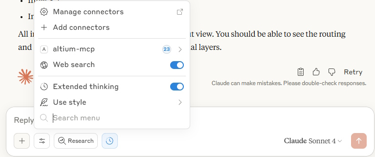

# Altium MCP Server

TLDR: Use Claude to control or ask questions about your Altium project.
This is a Model Context Protocol (MCP) server that provides an interface to interact with Altium Designer through Python. The server allows for querying and manipulation of PCB designs programmatically.

## Example commands
- Run all output jobs
- Create a symbol for the part in the attached datasheet and use the currently open symbol as a reference example.
- Create a schematic symbol from the attached MPM3650 switching regulator datasheet and make sure to strictly follow the symbol placement rules. (Note: Need to open a schematic library. Uses `server\symbol_placement_rules.txt` in the extension's install folder as pin placement rules. Please modify for your own preferences; an extension update replaces the file, so keep a copy.)
- Create an op-amp symbol with a triangle body like the other op-amps in my library (symbols support line/polygon/arc/ellipse/label body graphics, not just rectangles)
- Find me the LM358 symbol in my opamp library and open it
- Create a multi-part symbol for a quad op-amp from the attached LM324 datasheet (creates parts A, B, C, D with shared V+/V- power pins)
- Create a PCB footprint for the SMD part in the attached datasheet and add it to my open PcbLib
- In the active PCB footprint library, set all pad shapes to rounded rectangle except footprint 53398-0271
- In the active PCB footprint library, move all primitives from Mechanical 13 to Mechanical 1 and Mechanical 15 to Mechanical 3, except footprint 53398-0271
- In the active PCB footprint library, create Draftsman-style projections of embedded 3D STEP bodies on Mechanical 2 with 0.1 mm tracks, except footprint 53398-0271
- List every footprint in the active PCB footprint library
- Duplicate my selected layout. (Will prompt user to now select destination components. Supports Component, Track, Arc, Via, Polygon, & Region. Use `layout_duplicator_apply_groups` when copying the same selected routing to multiple destinations.)
- Show all my inner layers. Show the top and bottom layer. Turn off solder paste.
- Rename PCB layer 4 back to Int2 DDR and layer 32 back to Bottom Layer.
- Clear the Route Tool Path layer override so Top Layer displays with its normal layer-stack name.
- Get me all parts on my design made by Molex
- Give me the description and part number of U4
- Place the selected parts on my pcb with best practices for a switching regulator, then verify clearances and show me a screenshot of the result
- Auto-place my silkscreen, then fix the designators the placer left on top of parts or far from them
- Give me a list of all IC designators in my design
- Get me all length matching rules
- Check my project is ready for fabrication: unsaved documents, ERC errors, and which layers my Gerber output job plots
- Draw a schematic of an LED with a current-limiting resistor on a new sheet, using symbols from my library

## Videos
- [RP2354B Symbol & Footprint w/ Claude](https://youtu.be/m8W89txJ2wY): tell Claude to build a symbol and footprint, and it handles the rest
- [Can Opus 5.5 make a 6,545 pin symbol in Altium?](https://youtu.be/H8aqGX4gpH8): a symbol for the XCVP1902, made in Claude Code
- [Can Opus 5.5 make difficult Altium footprints?](https://youtu.be/DOWtJsfCKPw): examples of Claude making difficult footprints

More on the [altium-mcp YouTube channel](https://www.youtube.com/@altium-mcp), including the install walkthrough and videos for individual tools below.

## Installing the MCP Server
The easiest way to install is to use Claude Code, point it to this repo and ask it to install it for you. Or alternatively, see below.

[Watch on YouTube](https://youtu.be/HKQMK-hluLs)

1. Make sure Claude has Python 3.10 to 3.14 installed: `drop down > File > Settings > Extensions > Advanced > Python`. If not, install Python and add it to PATH. Python 3.15 is untested (see [Bootstrap Venv](#bootstrap-venv-recommended)).
2. Download the `altium-mcp.dxt` desktop extension file from [releases](https://github.com/coffeenmusic/altium-mcp/releases)
3. In Claude Desktop on Windows: `drop down > File > Settings > Extensions > Advanced > Install Extension...` Select the .dxt file

You shouldn't need to restart Claude and you should now see altium-mcp in the tool menu near the search bar.



## Creating a new .dxt (For Developers)

### Bootstrap Venv (Recommended)

This approach ships a small bootstrap script (`start_server.py`) that creates a virtual environment and pip-installs dependencies on the user's machine at first launch. The .dxt is small (about 300 KB) and works on Python 3.10 to 3.14.

**Python versions:** 3.10 to 3.13 install the hash-locked `requirements.txt`. 3.14 has no wheel for the locked pillow, so it installs the fallback list in `start_server.py` instead. With `mcp` 1.30 that list no longer caps pydantic, so it also resolves on 3.15, but 3.15 has not been tested.

The older approach of bundling pre-compiled packages in `server/lib/` is no longer recommended — it breaks when the user's Python version doesn't match the version used to build the bundled `.pyd` files (e.g. pydantic_core compiled for 3.11 fails on 3.13).

**How it works:**

1. `start_server.py` (at the repo root) looks for a ready virtual environment in `%USERPROFILE%\.altium-mcp\venvs\<key>`, where `<key>` is a hash of the pinned requirements and the Python version
2. If it isn't ready, it starts a **detached** builder process (`start_server.py --build`) that creates the venv and pip-installs the dependencies, then waits for it. It installs the hash-locked `requirements.txt` when the package contains it, and falls back to the short `REQUIREMENTS` list in `start_server.py` when the file is missing or the locked wheels don't fit the interpreter. Claude Desktop kills a server that has not answered within about 60 seconds, and restarts servers freely; a build that ran inside the launcher died with it. The detached builder finishes regardless, so a restarted launcher finds the venv ready or a build still in progress.
3. An operating system lock allows one builder at a time for each environment. When the builder exits, the operating system releases the lock. Run `start_server.py --build` directly to finish a build outside the client's startup timeout.
4. It then launches `server/main.py` using the venv's Python
5. First launch takes ~20-30 seconds; subsequent launches are instant

The venv, `config.json`, `build.log` and the server log `altium_mcp.log` live in `%USERPROFILE%\.altium-mcp`, not in the extension folder, because Claude Desktop replaces the extension folder on every update. The slow build therefore happens once per machine (and again only when the requirements or Python version change), and a hand-picked Altium path survives updates. AppData is deliberately avoided: Claude Desktop is an MSIX package, and writes its child processes make under AppData are redirected into `...\Packages\Claude_...\LocalCache`, so a venv built from a terminal and one built by the server would end up in different places. Set the `ALTIUM_MCP_HOME` environment variable to use a different folder. A `config.json` left beside `server/main.py` by an older version is migrated automatically on first start. The server log rotates at 1 MB (three backups) and records INFO and above; set `ALTIUM_MCP_LOG_LEVEL=DEBUG` to include every MCP protocol message.

On a slow network the first build can exceed the client's 60-second startup timeout. The build carries on in the background, so restarting the extension once it has finished is enough; `build.log` shows progress.

**Build steps:**

1. Make sure `start_server.py` exists at the repo root
2. Make sure `server/main.py` does NOT have the old `site.addsitedir` hack at the top
3. Update `manifest.json`: set `entry_point` to `start_server.py`, remove any `env`/`PYTHONPATH` fields, and use `manifest_version: "0.3"`
4. Package the DXT — either use `dxt pack` or manually zip and rename:
```powershell
Compress-Archive -Path manifest.json, start_server.py, pyproject.toml, requirements.txt, server, LICENSES -DestinationPath altium-mcp.zip
Rename-Item altium-mcp.zip altium-mcp.dxt
```
   Build from a clean checkout. Release packages leave out `server/tests/`, `__pycache__` folders, `*.pyc` and log files.

**Do NOT include `server/lib/` or `server/.venv/` in the .dxt.** The whole point is that these are created on the user's machine.

**`start_server.py`:** use the file at the repo root as is. It is no longer reproduced here, so the two cannot drift apart.

**`manifest.json` server section:**
```json
"server": {
    "type": "python",
    "entry_point": "start_server.py",
    "mcp_config": {
      "command": "python",
      "args": ["${__dirname}/start_server.py"]
    }
  }
```

### Pitfalls

These are hard-won lessons from debugging DXT builds. Violating any of these will produce errors that are difficult to diagnose.

1. **Do NOT use `os.execv()` in `start_server.py`.** The DXT installs to a path containing spaces (`Claude Extensions`). On Windows, `os.execv` splits the path at the space and fails. Use `sys.exit(subprocess.call([...]))` instead.

2. **Pin `mcp` to an exact version (now `==1.30.0`) and upgrade it deliberately.** An open range pulls in whatever is newest, and FastMCP has changed under the server before: 1.x dropped the `description` kwarg of `FastMCP.__init__()`, and in later 1.x releases a tool declared `-> str` sends its result a second time as `structuredContent` unless it is registered with `structured_output=False` (what `_tool()` in `main.py` does). mcp 2.x is not supported.

3. **Do NOT use `manifest_version: "0.4"` with `"type": "uv"`.** Claude Desktop does not support it yet. You will get `Invalid manifest: server: Required`. Use `"type": "python"` with `manifest_version: "0.3"`.

4. **After removing the `site.addsitedir` hack from `main.py`, fix the `pathlib.Path` reference.** The hack included `import pathlib` at the top of the file. The logging setup later uses `pathlib.Path(...)` which will throw `NameError` once that import is gone. Change it to `Path(...)` — the `from pathlib import Path` import already exists in the file, just make sure it comes before the logging setup.

5. **Do NOT bundle `server/lib/` in the DXT.** That was the old approach and defeats the purpose of the venv bootstrap.

### Legacy: Bundled server/lib (Not Recommended)

This approach bundles all dependencies in `server/lib/` and sets `PYTHONPATH` to point to it. It produces a much larger .dxt (~17 MB) and **only works if the user's Python version matches the version used to compile the bundled packages**.

1. Populate packages: `python -m pip install --no-cache-dir --target server/lib -r requirements.txt`
2. Set the manifest `entry_point` to `server/main.py` and add `"env": {"PYTHONPATH": "${__dirname}/server/lib"}` to `mcp_config`
3. Package: `npm install -g @anthropic-ai/dxt && dxt pack`

### DXT Resources
- [Desktop Extensions](https://www.anthropic.com/engineering/desktop-extensions)
- [Desktop Extensions Github](https://github.com/anthropics/dxt)
- [Getting Started with DXT](https://support.anthropic.com/en/articles/10949351-getting-started-with-local-mcp-servers-on-claude-desktop)
- [Python DXT Example Code](https://github.com/anthropics/dxt/tree/main/examples/file-manager-python)
- [DXT Manifest](https://github.com/anthropics/dxt/blob/main/MANIFEST.md)


## Configuration

The server discovers Altium Designer through its registry entries, running process, or installation folders. To select an installation, set `ALTIUM_EXE_PATH` to the full path of `X2.EXE` or set `altium_exe_path` in the data folder's `config.json`. If discovery fails, the first Altium tool call reports the configuration path.

## Available Tools

The server provides several tools to interact with Altium Designer:

### Routing inspection, audits and explicit edits

The server includes versioned PCB snapshots, exact before/after comparisons,
native DRC report ledgers, object-specific routing-rule queries, net/object
selection, explicit track/via batches, polygon outlines and repour, layer-use
audits, and approximate clearance previews. Write-capable routing tools default
to dry run and never save the board. See [the routing guide](docs/routing.md) for
schemas, units, recovery and validation limits. Reconnect MCP after updating to
discover the new tools.

- Snapshots and audits use `export_pcb_routing_snapshot`, `compare_pcb_snapshots`,
  `audit_pcb_layer_usage`, and `preview_pcb_route_clearance`.
- Native DRC reports use `export_pcb_drc_report`, `summarize_pcb_drc`, and `compare_pcb_drc`.
- Routing operations use `get_effective_routing_rules`, `select_pcb_routing`,
  `apply_pcb_routing_batch`, `set_pcb_polygon_outline`, `repour_pcb_polygons`, and `undo_pcb_routing`.
- Use `plan_pcb_diff_pair` for native differential pairs with optional paired
  through-via transitions, `measure_pcb_path_lengths` for track-and-via lengths
  and skew, and `plan_pcb_length_match` to tune individual nets or several
  differential pairs inside explicit corridors.
- Recovery uses `get_altium_command_status` for the bridge receipt and
  `get_pcb_routing_operation` for progress and reconciliation.

Passive capture/timelapse and verified saved-file checkpoints remain standalone
[optional utilities](tools/optional/README.md), outside the MCP request loop.

### Output Jobs
- `get_output_job_containers`: Reads all available output containers from the `.OutJob` at `outjob_path` (a full path, optional) or, without one, from the first OutJob open in a project
- `run_output_jobs`: Pass a list of output job container names to run any number of them, from the `.OutJob` at `outjob_path` or the first open one. The OutJob's project must be open in Altium. PDF containers report `output_verified` once the PDF is written. If the PDF already exists and the container prompts before overwriting, Altium asks in a dialog and the run waits for the answer.
- `get_outjob_settings`: Read any `.OutJob` file from disk (no Altium needed, the OutJob does not have to be open) and return its containers (output paths, file name expression, add-to-project) and outputs (connected containers, variant, document) with decoded settings: Gerber units/format/origin and the plotted and "add to all plots" layers decoded from Altium layer IDs, NC Drill, IPC-D-356 test points, pick and place, print layers and BOM sections. Use it to audit fabrication settings before generating. Reads the saved file, so unsaved changes in Altium are not visible.
- `create_outjob`, `edit_outjob`: Create an OutJob (from one of your OutJobs as a template, or empty) and add it to a project; change its containers (add a PDF or generated-files container with its folder and file name, rename, remove) and outputs (copy an output from another OutJob into chosen containers, remove, rename, enable, move between containers, change one setting of its configuration). Edits keep everything else exactly as Altium wrote it, and nothing is written when any operation fails; an OutJob open in Altium is closed first and reopened after, and Altium is not started for an edit. A new container copies the settings of one of its type but not its folder or file name. Contributed by [SiboVG](https://github.com/SiboVG) ([PR #75](https://github.com/coffeenmusic/altium-mcp/pull/75)).

### Project & Validation

- `validate_altium_project` checks project inventory, schematic-to-PCB designators,
  and the outcome of Altium's native batch DRC. See [project validation](docs/routing.md#read-only-project-validation).
- `list_open_documents`: List the documents open in Altium with their path, kind, whether they have unsaved changes and which one is in front.
- `reload_document`: Close an open document and open it again from disk, e.g. after the file was replaced outside Altium (which otherwise saves its own copy over it). A document with unsaved changes is refused unless `discard_changes`. Returns the file's size and modification time as loaded.
- `get_project_info`: Focused project's parameters, documents with their state (`closed` / `open` / `modified` = unsaved changes in memory), schematic sheet count and variants with their variations (e.g. Not Fitted parts). Read-only; use it to confirm nothing is unsaved before generating outputs.
- `preview_eco`: What Design > Update PCB would change, as data, without running it: components to add, remove or change (designator, footprint, comment), nets to add, remove or rename, pins changing net, component and net classes, and rooms the update would add or remove. Components match by unique id and nets by their pins, as the comparator does. The project's saved options are followed: kinds the comparator ignores or the ECO does not generate, and classes and rooms Class Generation does not make, are left out and counted in `skipped_by_project_options`. Board parts with no schematic link are listed apart (`board_only_components`), as the ECO leaves them alone. Also explains duplicate component class names (Altium's "Class already exists" warning from a sheet symbol that lists several files). Not compared: net class members, component parameters, differential pairs, rules from parameter sets, and room scope and members, so an empty result means no differences of the kinds compared. Read-only: compiles in memory and reads the board without bringing it to the front (a board it had to open is closed again; one already open stays open). Contributed by [SiboVG](https://github.com/SiboVG) ([PR #84](https://github.com/coffeenmusic/altium-mcp/pull/84)).
- `compare_netlist`: Compile a project and compare its netlist with a saved snapshot: the safety net for editing sheets in place. Lists nets that gained or lost pins, pins moved between nets, nets added, removed or renamed (an auto-named net whose pins stay together is a rename; nets are matched by name, then greedily by most shared pins) and nets left with a single pin. By default each call compares with the previous one and saves itself (`against` / `save_as` name a fixed baseline). Snapshots are kept per project by its full path, so a copy of a project in another folder keeps its own; the 20 most recently saved per project are kept and older ones removed (listed in `pruned`). A malformed snapshot gives an error, not a comparison. Read-only: compiles in memory. Contributed by [SiboVG](https://github.com/SiboVG) ([PR #93](https://github.com/coffeenmusic/altium-mcp/pull/93)).
- `get_project_components`: The components of the compiled project with their schematic Comment, footprint, library reference and sheet (optionally all parameters, or only the ones you name). Filter by designator (wildcards such as `R*`) or sheet; a large project comes in pages, and `next_offset` says where to go on. Use it for BOM work: the instance Comment is where generic passives keep their value, which PCB-side tools and ActiveBOM may not show. Takes an optional `project_path`, as `get_erc_violations` does.
- `get_erc_violations`: Compile a project in memory (nothing is saved) and list compiler/ERC violations with their level (fatal / error / warning). Give `project_path` (a `.PrjPcb`, opened if needed) to compile exactly that project; without it the focused project is compiled, and Free Documents is refused. The result names the project it compiled and lists the sheets compiled from unsaved changes in Altium (`unsaved_in_altium`) and those missing on disk. Violations are read from the project object - the per-document `DM_ViolationCount` does not exist in recent Altium versions. `project_path` contributed by [SiboVG](https://github.com/SiboVG) ([PR #80](https://github.com/coffeenmusic/altium-mcp/pull/80)).
- `get_board_summary`: Fabrication-oriented summary of the focused PCB in mm: board outline (bounding box, size, vertices) and origin, dimension objects, vias by hole size, components per side, primitive counts per layer (free vs. inside components, e.g. to see which mechanical layers hold the assembly outlines) and the free texts on both overlays.
- `get_component_primitives`: Every primitive of the given components with its layer (pads with size and solder/paste mask expansion, arcs, tracks, texts). Catches footprints that were flipped to the bottom side but kept part of their copper or mask opening on the top (e.g. fiducials).

### PCB image exports

- `export_pcb_3d_image`: Export one native orthographic top or bottom PCB 3D PNG without creating or opening an OutJob. The default is 600 DPI. Optional `workspace_color`, `board_color`, `solder_mask_color`, `silk_color`, and `copper_color` arguments accept `#RRGGBB`; omit all colors to use the current Altium 3D colors.
- `export_pcb_3d_images`: Export both `pcb-3d-top.png` and `pcb-3d-bottom.png` with the same DPI and color options.
- `export_pcb_assembly_images`: Export top and bottom Mechanical 2 assembly artwork, pad geometry, and the actual board contour. PNG output is RGBA with transparent background and defaults to 600 DPI. The board contour is black and 0.1 mm wide by default; `top_color`, `bottom_color`, `outline_color`, and bottom mirroring are configurable. Set `keep_svg=true` to retain the vector files and their pad metadata.
- `export_component_assembly`: Export the requested PCB component's Mechanical 2 assembly artwork and pads as both SVG and transparent RGBA PNG. This reuses EasyEDA-Loader's normal shape SVG conversion, including its arc, region, track, text, flipped-layer, component-origin, and pad-contour handling.

All SVG exports that include pads place them in `<g id="Pads" data-layer="pads">`. Each pad path stores its Altium pad number without drawing extra text, for example `<path id="U1-pad-1" data-component="U1" data-footprint="QFN-32" data-pad-number="1" data-pad-index="17" .../>`. The pad number is the PCB pad designator used by Altium's schematic-pin-to-footprint-pad mapping. On panelized boards, repeated designators receive unique SVG IDs and a `data-instance` suffix while retaining the original `data-component`. SVG grouping and metadata do not survive rasterization, but pad geometry is rendered into the PNG.

The two Mechanical 2 tools require the current EasyEDA-Loader Altium extension because they use its in-process named-pipe bridge. These commands are read-only: they do not modify or save the PCB/PcbLib document. Responses include `pad_count` and `pads_included`.

#### Using SVG pad numbers

When a task needs pad numbers, pin callouts, connector pinouts, or correspondence
with schematic pins, use the SVG metadata rather than OCR or the order of the
paths:

1. For a whole-board export, call `export_pcb_assembly_images` with
   `keep_svg=true`. `export_component_assembly` always retains its SVG.
2. Select `<path>` elements below `<g id="Pads" data-layer="pads">`.
3. Read `data-pad-number` as the Altium PCB pad designator used by the
   schematic-pin-to-footprint-pad mapping.
4. Read `data-component` for the logical component designator. On panelized
   boards, combine it with `data-instance` to distinguish repeated copies.
5. Use `data-footprint` when the footprint identity is also required.

Do not derive pad numbers from SVG path order, pad position, rendered PNG
pixels, or OCR. PNG exports contain the visible pad shapes but cannot retain the
SVG attributes.

All component and whole-board SVGs use millimetres for physical dimensions and
view-box/path coordinates. The root records `data-coordinate-units="mm"` and
uses `mm` suffixes for `width` and `height`. `BoardOutline` uses
`stroke="#000000"`, `stroke-width="0.1"`, and
`data-stroke-width-mm="0.1"`; because SVG user coordinates are millimetres, its
rendered width is 0.1 mm.
The `BoardShape` layer also contains real SVG `<circle>` elements for holes in
standalone pads when the drilled-hole diameter is at least 1 mm. These elements
carry `data-kind="standalone-mounting-pad"` and `data-hole-diameter-mm`.
Component-owned pads, standalone pads without holes, and vias are excluded from
this mounting-hole subgroup. The full drilled-hole circle must fit inside the
actual PCB outline; panel-rail pads outside that contour are excluded.

### Document Utilities
- `save_current_document`: Save the currently focused Altium document. Requires `user_requested=true`; use it only when the user explicitly asks to save.

### Project variant material changes

- `get_project_variants` (`project_name`): Inspect one open PCB project's live
  variants, component IDs, variation kinds, alternate-part strings, and parameter
  overrides. Use the exact project basename without `.PrjPcb`, or its full path.
  The displayed variant label is `DM_Description`; `DM_Name` can simply be
  `Variant` and should not be used to select `E1_MOUNT`.
- `copy_project_variant_materials` (`source_project`, `target_project`, `variant_name`,
  `allow_missing=False`, `apply=False`): Preflight a material-override copy. The
  default checks all source changes without creating a variant. Set `apply=True`
  to create the target variant. Missing components block by default; set
  `allow_missing=True` only after reviewing `skipped_designators`.
- `extend_project_variant_material(source_project, target_project, variant_name,
  library_reference, apply=False)`: Extend an existing variant to missing
  instances of one exact base material in the target. This is a separate dry-run
  step after copying by designator. It requires **every** source instance of that
  library reference to have the same base comment/footprint and identical fitted
  material overrides. Partial or conflicting source substitutions cannot become
  a global material rule. Conflicting existing target overrides also block the
  operation. Matching overrides are preserved; only missing ones are appended.
- `get_project_variant_materials(project_name, variant_name,
  library_reference_prefix)`: Audit all compiled components in a material family,
  including those with **no override**. Returns base and effective Comment,
  calculated PartNumber where overridden, and the project's active variant label.
  Use this to verify that a material substitution covers the full target BOM.

The implementation is in `server/AltiumScript/project_variants.pas`, registered in
`Altium_API.PrjScr`, with MCP wrappers in `server/main.py`. It uses open projects
and compiled schematic data. Each source designator must identify one component,
and its stored variant ID must match the compiled source ID. Each target match
must have the same base library reference, comment, and footprint. Overrides use
the **target** component's ID, so copied hierarchy IDs cannot silently attach to
another component. Ambiguous designators, stale source IDs, incompatible base
parts, and conflicting existing variants block the operation. An identical
existing variant returns `already_matches=true` without adding another variant.

This helper supports fitted components with parameter/material overrides only
(`DM_VariationKind=0`). It does not copy DNP states or alternate library models.
It preserves the source alternate-part string and all parameter name/value
overrides. In AD26, `DM_SetAlternatePart` automatically creates a `Comment`
override; the copier reuses that parameter to avoid duplicates. Every new
component variation is read back before success. On failure, the newly created
variant is removed; inspect the live state before retrying.

Example MCP arguments, first for preflight and then for applying reviewed skips:

```json
{"source_project":"SwarmRK_v1.6S","target_project":"MainRK_v1.6","variant_name":"E1_MOUNT"}
{"source_project":"SwarmRK_v1.6S","target_project":"MainRK_v1.6","variant_name":"E1_MOUNT","allow_missing":true,"apply":true}
```

The `SwarmRK_v1.6S` -> `MainRK_v1.6` copy, including the material-population
correction verified on 2026-10-19, has these 18 component changes and 36 parameter
overrides:

| MainRK components | Variant `Comment` | Variant `PartNumber` |
| --- | --- | --- |
| HL2, HL3, HL5, HL6, HL7, HL8, HL10 | XL-1608SYGC-06 | =Comment |
| F1, F2, F3, F4, F5, F8, F11, F12, F14, F15, F16 | 0R | =Comment |

The source's `HL11`, `HL12`, and `F6` are absent from MainRK and were skipped.
Other MainRK components retain their base values. The initial exact-designator
copy added 14 changes but missed MainRK-only `F8`, `F11`, `F12`, and `F15`. SwarmRK
has eight `MFU0603FF00500P500` instances and replaces all eight with `0R`; MainRK
has eleven. The material extension added the four missing target overrides.
Altium's `DM_CalculatedAlternatePart` and `DM_CalculatedValue` then confirmed
`Comment=0R` and resolved `PartNumber=0R` at **all eleven** fuse positions, with no
remaining effective `MFU*` value. A repeat extension reported zero pending changes.
An override-only audit would miss this regression; always include unoverridden
target instances when verifying material replacements. The base library reference
remains `MFU0603FF00500P500`; the substitution is applied within `E1_MOUNT`.

After the initial copy, use these MCP arguments for the extension and audit:

```json
{"source_project":"SwarmRK_v1.6S","target_project":"MainRK_v1.6","variant_name":"E1_MOUNT","library_reference":"MFU0603FF00500P500"}
{"source_project":"SwarmRK_v1.6S","target_project":"MainRK_v1.6","variant_name":"E1_MOUNT","library_reference":"MFU0603FF00500P500","apply":true}
{"project_name":"MainRK_v1.6","variant_name":"E1_MOUNT","library_reference_prefix":"MFU"}
```

Run these through `extend_project_variant_material` (first two) and
`get_project_variant_materials` (third). After extension, the target intentionally
has more override records than the source. Repeating the exact-designator copier
can therefore report a conflict; repeat the material-extension preflight to check
its idempotence instead.

**Save-state recovery:** These tools issue no save command. Keep Altium open for
inspection. On the tested AD26 project server, `SetModified(True)` did not make
`GetModified` return true even though the live variant and its overrides were
present. Responses therefore expose `target_modified` and a `save_state_warning`
when persistence cannot be confirmed. A successful live readback does not prove
that the project is saved. Report this ambiguity; do not restart/close Altium,
save, or accept a save-copy prompt without the user's explicit instruction.

Existing MCP connections may need a **server reconnect** to discover the new
tool names; Altium itself does not need a restart. Until reconnection, the existing
`move_pcb_library_mechanical_layers` tool can carry one project maintenance command
in `layer_moves`, with `exclude_footprint_names=[]`:

```text
PROJECT_VARIANTS_INSPECT|MainRK_v1.6
PROJECT_VARIANT_MATERIALS|SwarmRK_v1.6S|MainRK_v1.6|E1_MOUNT|TRUE|DRY_RUN
PROJECT_VARIANT_MATERIALS|SwarmRK_v1.6S|MainRK_v1.6|E1_MOUNT|TRUE|APPLY
PROJECT_VARIANT_EXTEND_MATERIAL|SwarmRK_v1.6S|MainRK_v1.6|E1_MOUNT|MFU0603FF00500P500|DRY_RUN
PROJECT_VARIANT_EXTEND_MATERIAL|SwarmRK_v1.6S|MainRK_v1.6|E1_MOUNT|MFU0603FF00500P500|APPLY
PROJECT_VARIANT_EFFECTIVE_MATERIALS|MainRK_v1.6|E1_MOUNT|MFU
```

The parser dispatches these commands before PCB-library operations. The dedicated
tools use `project_variant_maintenance`, which also bypasses document focusing.
After any timeout, inspect the target variant and its exact overrides before
retrying an apply. Put exported verification data under `generated/`.

### Component Information
- `get_all_designators`: Get a list of all component designators in the current board
- `get_all_component_property_names`: Get a list of all available component property names
- `get_component_property_values`: Get the values of a specific property for all components
- `get_component_data`: Get detailed data for specific components by designator
- `get_component_pins`: Get pin information for specified components

### Schematic/Symbol
- `get_schematic_data`: Get schematic data for specified components
- `create_schematic_symbol` ([YouTube](https://youtu.be/MMP7ZfmbCMI)): Passes pin list with pin type & coordinates to Altium script. Supports multi-part symbols (e.g. quad op-amps) via a `part_count` parameter and an `owner_part_id` field on each pin (use 0 for shared power/GND pins), active-low pin name overbars by placing a backslash after each overbarred character (e.g. `R\E\S\E\T\` renders as `RESET` with overbar), per-pin length and name/designator visibility, and an optional `graphics` list (lines, polylines, polygons, rectangles, arcs, ellipses, labels) for non-rectangular bodies like op-amp triangles and diode glyphs. When creating a symbol, the agent is instructed to first look up a similar symbol in an available library as a style reference (skipped gracefully if no library is available). Symbol metadata can be passed in the same `pins` list with entries such as `Comment=<symbol_name>`, `Designator=DD?`, `Manufacturer=<name>`, `Parameter=PartNumber|=Comment`, `Parameter=ValueType|Микросхема`, `Parameter=<custom_name>|<custom_value_or_blank>`, `Footprint=<footprint_name>`, `FootprintLibrary=<library_name_or_path>`, and `PinDescription=<pin>|<datasheet description>`.
- `get_symbol_primitives`: Inventory a .SchLib (every symbol with per-type primitive counts) or dump one symbol's complete geometry (all graphics + pin details, in mils; `symbol_name="*"` dumps every symbol). Used to gap-analyze a library, to give the agent a reference example when drawing a new symbol, and to verify recreations. The symbol creator round-trips a complete production library set exactly - 514/514 symbols across IC, connector, misc, and passives libraries (dump -> recreate -> dump -> diff, zero differences). Footprint/model links (implementations) are metadata outside the graphics round-trip. Each dumped symbol also reports its Comment (`text`, `visible`) and its parameters (`name`, `value`, `visible`, location in mils as Altium holds it, `justification`, `autoposition`, `font` name and size), and each pin its `description`, its four IEEE symbols (`symbol_inside`, `symbol_inside_edge`, `symbol_outside_edge`, `symbol_outside`) and its parameters (`name`, `value`), so the agent can check symbol properties after setting them.
- `create_symbols_batch`: Create or edit many symbols in one script run from a plain-text spec file (bulk imports/migrations) - far faster and more robust than one create call per symbol. Besides `SYMBOL`, `PIN` and `GRAPHIC` records it takes:
  - `EDITSYMBOL|<name>`: edit an existing symbol. A symbol that is not in the library is reported under `failed`, never created.
  - `COMMENT|<text>[|<visible 1/0>]`: set the Comment. It is hidden unless the visible field is 1. The library editor keeps its own copy of the Comment of the symbol on screen and writes that copy back when it shows another symbol, so for that symbol the tool sets both.
  - `DESCRIPTION|<text>`: set the Description.
  - `SYMPARAM|<name>|<value>|<visible 1/0>[|x|y[|justification[|font]]]`: add or replace a symbol parameter. By default, visible parameters without a location go below the body's bottom-left corner, left-aligned, 100 mil apart in record order. The optional justification is `bottom_left`, `bottom_center`, `bottom_right`, `center_left`, `center`, `center_right`, `top_left`, `top_center` or `top_right`. The optional font is `<font name>:<size>`, for example `Arial:10`; it is looked up by name with `FontManager.GetFontID`, which adds it to the document when missing, because font IDs differ between documents. Leave a field empty to skip it and still give a later one; omitted fields keep the parameter's own. A parameter the tool positions gets Autoposition off, so Altium does not move it afterwards.
  - `PINPARAM|<pin number>|<name>|<value>`: add or replace a hidden parameter on every pin with that number (every part of a multi-part symbol).
  - `PINDESC|<pin number>|<text>`: set the Description of every pin with that number.
  - `PINSYMBOL|<pin number>|<edge>|<symbol>`: set an IEEE symbol of every pin with that number. The edge is `inside`, `inside_edge`, `outside_edge` or `outside`. The symbol is a TIeeeSymbol name without the leading `e`, in any case: `none`, `dot`, `clock`, `activelowinput`, `schmitt` and so on (the full list is in the altium-script skill, SCH_API_Reference.md, under TIeeeSymbol).
  - `PINFUNC|<pin number>|<F1>/<F2>/...` (optional): replace the Functions list (Properties panel > Pin > Functions) of every pin with that number, in the order given, for multi-function pins such as GPIOs. Nothing sets functions unless the spec has this record. A script cannot clear the list, so an empty one is listed under `problems`, and so is a stored list that differs, as when Altium merges a repeated name. `get_symbol_primitives` returns a pin's `functions` when it has any.

  These records work after `SYMBOL` and `EDITSYMBOL` alike. An unknown pin number, edge, symbol or justification is listed under `problems`; the rest of the batch still runs.

  The result lists `created`, `edited`, `failed` and `problems`. Created and edited symbols leave the library modified and unsaved, so the user reviews them and saves; the tool never saves a library. Objects a script adds through PreProcess/PostProcess do not reliably set Altium's modified flag (in a PCB library they never do), so the symbol and footprint tools set it themselves. A `LIBRARY|<path>` line focuses that library if it is already open (it never reloads it, which would discard unsaved symbols) and opens it otherwise. If that library cannot be focused, the batch stops before changing anything. The library editor draws the symbol it shows from a picture made when that symbol was shown, so new parameters on it would not appear: a batch that edited symbols therefore ends by showing another symbol and then that one again. A library with a single symbol has nothing to switch to; `problems` then says the new parameters appear once the library is reopened.
- `build_schematic`: Build a wired schematic on a new sheet from a circuit description: parts from a `.SchLib` (full path; `.IntLib` is not supported), wires, junctions, net labels, power ports and notes, in mils (fractions are kept, so metric positions are exact). Returns every placed pin's true connection point, so a second call can route wires from measured coordinates, and lists any part it could not place. The new sheet is kept out of your project.
- `check_schematic`: Check saved sheets for drafting problems: two-pin parts tapping their net at the pin, net labels away from their wire's free end or hanging off it, text touching wires, pins or other text (with a clear layout suggested), dangling wires, wires slightly out of level, parts whose pins sit a few microns off the grid, and sheet symbol layout. Takes a `.SchDoc`, a `.PrjPcb` or a folder and reads the saved files, so it needs no running Altium. Contributed by [SiboVG](https://github.com/SiboVG) ([PR #64](https://github.com/coffeenmusic/altium-mcp/pull/64), pins off the grid [PR #73](https://github.com/coffeenmusic/altium-mcp/pull/73)).
- `check_hierarchy`: Check that a project's sheets connect: every sheet entry against the ports of its child sheet (with rename suggestions for pairs that belong together under different names), harness types of entries and ports, one harness type defined differently on two sheets, signal harnesses whose type nobody gives (located, unlike the ERC's "Missing harness type"), and `.Harness` files out of step with their sheet. Reads the saved files, so it needs no running Altium.
- `edit_schematic`: Change an existing sheet: move, rotate, mirror, delete or place parts, set parameters, move designator and parameter text, add wires, net labels, power ports, junctions and no-ERC markers, and delete objects at a point. Coordinates are in mil or mm, so `check_schematic`'s suggestions apply directly. The whole edit is one undo step in Altium, and the sheet is saved only when asked. `place_component` also places a part from a database library (Excel tables) by `dblib` and `part_number`: the row gives the symbol, footprints, description and parameters (following the field map's visibility and Add To Design settings), and the part is linked to the DbLib as when Altium places it. It also edits sheet symbols (move, resize, colours, name and file name text) and their entries (side, distance, I/O type, style, name), moves a wire vertex together with the wires, junctions, net labels, power ports and port ends on it, and moves a net label, optionally onto the nearest wire end, keeping its font and colour. Contributed by [SiboVG](https://github.com/SiboVG) ([PR #70](https://github.com/coffeenmusic/altium-mcp/pull/70), DbLib parts [PR #91](https://github.com/coffeenmusic/altium-mcp/pull/91), sheet symbols, wire vertices and label moves [PR #92](https://github.com/coffeenmusic/altium-mcp/pull/92)).
- `get_schematic_pins`: The pins of a sheet's parts, live from Altium: connection point, number, name, electrical type. `edit_schematic` also takes pin references ("U20.VCC", "U20.3", "U1A.3" for part A of a multi-part part) wherever it takes a point, and `add_port` places a port with a fixed width (auto size off). Pins are read before the edit runs, so a part moved or placed in the same call is referred to in a second call. Contributed by [SiboVG](https://github.com/SiboVG) ([PR #78](https://github.com/coffeenmusic/altium-mcp/pull/78)).
- `render_sheet`: A picture of a schematic sheet or part of it (wires, buses, junctions, component bodies with pin names and numbers, net labels, power ports, ports, sheet symbols, texts), read from the .SchDoc file, so the sheet need not be open. Contributed by [SiboVG](https://github.com/SiboVG) ([PR #87](https://github.com/coffeenmusic/altium-mcp/pull/87)).
- Before creating or editing schematic symbols, read [server/symbol_placement_rules.txt](server/symbol_placement_rules.txt). This is the project rule set future chats should use for pin placement, connector designators, descriptions, and symbol styling.
- The default workflow for GOST schematic-library symbol creation is documented in [Schematic.md](Schematic.md). Use it by default for GOST schematic-library symbol creation, update, and review tasks. The standard MCP flow is `get_symbol_placement_rules` -> `search_library_symbol` -> `get_library_symbol_reference` -> `create_schematic_symbol`; pass GOST custom properties through `Comment=`, `Manufacturer=`, `Parameter=`, `Footprint=`, `FootprintLibrary=`, and `PinDescription=` metadata entries.
- `get_symbol_placement_rules` reads the included [symbol placement rules](server/symbol_placement_rules.txt).
- `get_library_symbol_reference`: Create symbol's helper tool to use an open library symbol as an example to create the symbol
- `get_library_symbol_primitive_font_dump`: Read-only active SchLib symbol primitive/font audit. Dumps pins, rectangles, lines, labels, parameters, and FontManager-resolved fonts from the active in-memory library component; rectangle records include border `line_width`, outline colour, fill/area colour, and whether solid fill is enabled. GOST generated body rectangles use black outline color `0`, `#F8F8F8` fill color `16316664`, and solid fill enabled. Use this instead of reading `.SchLib` files directly when exact style/font auditing is needed.
- `search_library_symbol`: Search for a symbol by name in a schematic library (.SchLib) and navigate to it. Supports partial name matching. Will open the library file in Altium if a path is provided, or show a file picker if not.

Library paths (`library_path`, `LIBRARY|`, `FPLIB|`) may contain commas and may be spelled in a different case or with forward slashes; `LIBRARY|` and `FPLIB|` paths may also use short (8.3) folder names. An open library is matched to its path after normalizing case and separators, so the tools never open a second copy of it.


### Layout Operations
- `get_all_nets`: Returns a list of unique nets from the pcb
- `create_net_class` ([YouTube](https://youtu.be/89booqRbnzQ)): Create a net class from a list of nets
- `get_pcb_layers`: Get detailed layer information including electrical, mechanical, layer pairs, etc.
- `get_pcb_layer_stackup`: Gets stackup info like dielectric, layer thickness, etc.
- `set_pcb_layer_visibility` ([YouTube](https://youtu.be/XaWs5A6-h30)): Turn on or off any group of layers. For example turn on inner layers. Turn off silk. Names are matched as Altium spells them anywhere ("Multi-Layer", "Top Solder", "Mid Layer 1" for a renamed inner layer); an unknown name changes nothing and the reply lists the board's layers. Every reply has `previous_state`, which `restore_state` puts back.
- `set_pcb_layer_names_by_id`: Rename PCB copper or mechanical layers by numeric `layer_id` from `get_pcb_layers`. Pass entries as `layer_id|new name`, for example `["1|Top Layer", "4|Int2 DDR", "32|Bottom Layer"]`. This changes layer-stack names only; it does not save the PCB document.
- `clear_pcb_route_tool_path_layer`: Clear Altium's route-tool-path layer override. Use this when a copper layer appears as `Route Tool Path` even after its layer-stack name has been restored.
- `get_pcb_rules`: Gets the rule descriptions for all pcb rules in layout.
- `run_drc`: Run Altium's design rule check on a board and list the violations, each with its rule, description, position, the objects involved and, where Altium gives them, the measured and allowed values in mils; plus the per-rule counts from Altium's report. Filter the list by rule name or kind (`rules`, whole names: "Clearance" is the electrical clearance rules only), by net or by area. The Design Rule Checker dialog flashes on screen while the tool presses Run; `ran` says whether the check really ran. Takes an optional `board_path`. Contributed by [SiboVG](https://github.com/SiboVG) ([PR #66](https://github.com/coffeenmusic/altium-mcp/pull/66), filters and values [PR #77](https://github.com/coffeenmusic/altium-mcp/pull/77)).
- `check_objects_drc`: Run the board's own design rules on chosen objects only (refs from `objects_in_area`, and/or every copper object in a box), without a batch DRC or its dialog: each object's width or hole-size rule, and the clearance, short-circuit and hole-to-hole rules against the copper near it, pour copper included (hits on pour copper, which is as last poured, are listed apart as `pour_violations`). Overlay, mask and mechanical objects are not checked. The rule is the one the DRC would pick and Altium's own check decides; `margin` sets how far neighbours are looked for; says so when nothing could be checked. Takes an optional `board_path`. Contributed by [SiboVG](https://github.com/SiboVG) ([PR #94](https://github.com/coffeenmusic/altium-mcp/pull/94)).
- `create_pcb_rule`: Add a design rule: clearance, width, hole size, routing via, solder or paste mask expansion, or polygon connect, with values in mils and Altium query scopes such as `InNet('GND')`. A rule added by script becomes priority 1 of its kind, so give it a narrow scope; the result warns when a rule scoped to everything now overrides others. Takes an optional `board_path`. Contributed by [SiboVG](https://github.com/SiboVG) ([PR #67](https://github.com/coffeenmusic/altium-mcp/pull/67)).
- `get_selected_components_coordinates`: Get position, rotation, layer, and footprint information for currently selected components
- `move_components`: Move specified components by X and Y offsets
- `set_component_position`: Set one component's absolute position and rotation
- `place_components`: Batch absolute placement - place any number of components (x, y, rotation, top/bottom layer, locked, and optionally the designator and comment text exactly as `get_layout` reports it) in a single transaction / one undo step, on the board named by `board_path`. The workhorse for AI-driven placement.
- `check_placement`: Verify a placement - finds overlaps and clearance violations against every other component on the board using true primitive-to-primitive distances (designator text excluded). Run after placing; a screenshot is not verification.
- `check_orientation`: Advisory check for 2-pad passives whose rotation could be improved (e.g. a decoupling cap with its GND pad facing away from the IC). Geometry only - review suggestions with judgement; parts like pull-ups don't care.
- `get_net_connections`: For the nets touching a set of components, list every pad on each net board-wide with per-net airline (MST) lengths - the data behind connectivity-driven placement (shorten critical nets, see off-cluster loads and filter banks).
- `check_routing`: Check the routed copper for segments that are not 0, 45 or 90 degrees and for right-angle and acute corners, with the net, layer and position of each. Run after editing tracks or vias; a screenshot does not show a stub 2 degrees off 45. Contributed by [SiboVG](https://github.com/SiboVG) ([PR #60](https://github.com/coffeenmusic/altium-mcp/pull/60)).
- `route_track`: Add a track through waypoints with every segment exactly 0, 45 or 90 degrees, optionally chamfering square corners; `dry_run` only returns the segments. It adds tracks only: no vias and no DRC. Contributed by [SiboVG](https://github.com/SiboVG) ([PR #60](https://github.com/coffeenmusic/altium-mcp/pull/60)).
- `route_path`: Route a net from a pad, via or point through waypoints, every segment 0, 45 or 90 degrees, changing layer with a via where a waypoint names another layer. Width and via size default to the net's width and routing via style rules. Every layer is checked against the board before anything is added; a surface-mount pad reached on another layer (a via in the pad) or a pad of another net is refused unless allowed. The new copper is one undo step and is then checked like `check_objects_drc`; `undo_on_violation` takes it off again within that step, and `dry_run` only plans. Use it when you choose the path (inner layers, blind vias, a set of waypoints) and want the result checked; use `route_connections` to have a group's unrouted connections found and routed for you. Takes an optional `board_path`. Contributed by [SiboVG](https://github.com/SiboVG) ([PR #95](https://github.com/coffeenmusic/altium-mcp/pull/95)).
- `place_vias`: Add vias at positions in mils from the board origin, with a default size, net and layer span that each via can override (blind and buried vias too). Every net and layer is checked against the board first, by Altium's layer name or the stack's own ("Inner 1"), so a bad entry adds nothing, and all the vias are one undo step. Takes an optional `board_path`. Contributed by [SiboVG](https://github.com/SiboVG) ([PR #68](https://github.com/coffeenmusic/altium-mcp/pull/68)).
- `place_polygon_pour`: Add a polygon pour from an outline of corners in mils on a signal layer, solid or hatched, with an optional net, and pour it. Takes an optional `board_path`. Contributed by [SiboVG](https://github.com/SiboVG) ([PR #69](https://github.com/coffeenmusic/altium-mcp/pull/69)).
- `place_cutout`: Add a polygon pour cutout on one signal layer or all of them, or a board cutout, and repour the polygons it overlaps. Takes an optional `board_path`. Contributed by [SiboVG](https://github.com/SiboVG) ([PR #69](https://github.com/coffeenmusic/altium-mcp/pull/69)).
- `delete_pcb_objects`, `modify_pcb_objects`: Rip up copper, or change its width, via size, net or layer: tracks, arcs, vias, polygon pours, copper regions, fills and pour cutouts picked by kind, net, layer and area, or a group's copper by `designators` (exactly what `get_layout` lists for the group). Only copper is touched - never pads, component primitives, keepouts or objects on other layers - and locked objects are left alone and listed unless `include_locked`. A filter must narrow the match. A via whose hole would not fit its diameter is left as it is. `dry_run` lists the matches; each edit is one undo step. Takes an optional `board_path`. Contributed by [SiboVG](https://github.com/SiboVG) ([PR #74](https://github.com/coffeenmusic/altium-mcp/pull/74)).
- `repour_polygons`, `get_pour_report`: Repour every polygon pour on a board, or those picked by name, net, layer or area, in pour order (where pours of different nets overlap, the order decides which gets the copper), as one undo step; and report what each pour poured (pieces, islands, slivers, no net, no copper). Shelved polygons stay shelved unless `include_shelved` is set. Takes an optional `board_path`. Contributed by [SiboVG](https://github.com/SiboVG) ([PR #71](https://github.com/coffeenmusic/altium-mcp/pull/71)).
- `get_layout`: Read the layout of a group of components or of an area: each component's placement, lock and designator and comment text, and the copper around them - tracks, arcs, vias, fills, copper regions, pour cutouts and polygon pours with their full outline (arc edges included) and pour settings. For a group it lists the copper wholly inside its extent plus the copper of its own nets (nets with no pad on another part) wherever it runs. The result is exactly what `place_components` and `place_copper` take.
- `place_copper`: Add copper in one undo step: tracks and arcs at any angle, vias, fills, copper regions, pour cutouts and polygon pours (arc edges, island and neck removal, pour order, pour over same net). Every net and layer is checked first, so a bad entry adds nothing; pours go in last and pour around the copper added with them. A `transform` (shift, rotate, mirror) and `rename_nets` place a layout read with `get_layout` somewhere else, e.g. to repeat a channel.
- `fanout_pads`: Fan out pads - a short track from each pad to a via beside it, e.g. to take an IC's ground and power pads down to their planes. Each via goes outward from the component first, as close as the clearance allows; a pad big enough to hold the via (an exposed thermal pad) gets it in the middle. Widths come from the board's width rules (no wider than the pad), the gap from its clearance rules. Pads that already have copper on them are left alone.
- `route_connections`: Route a group's unrouted connections automatically with a maze router: every segment 0, 45 or 90 degrees, keeping the clearance from other nets' copper on the layers allowed, and changing layer through a via where needed. Each net gets the preferred width of its width rule (its minimum where that finds no path) and the gap of its clearance rule. Wider nets go first, then shortest first; when a connection is walled in by earlier routes, the whole set is routed again with the failures first. Pours are not obstacles (repour afterwards). Everything goes in with one undo step, and the reply lists the routed and failed connections and what is still unrouted. Together with `delete_pcb_objects` (rip up a group's copper) this is the loop for routing a group from scratch: place, fan out, route, check, rip up and try again.

  Tested on groups of the 6-layer board below, placed and with the board's planes in: eleven of twelve groups (5 to 50 parts) routed completely, in 5 to 90 seconds each, with no clearance, short-circuit or width violations (several needed both outer layers, one also Mid Layer 2); the twelfth, the densest, kept 3 of its 63 connections unrouted, reported as failed.
- `get_unrouted_connections`: The connections still to be routed (the ratsnest) for some components, some nets or the whole board, naming the pad at each end and saying whether both ends lie in the group's area. No DRC run and no 500-violation limit. Altium does not update the ratsnest after copper a script adds, so the nets are analyzed first.

  Tested by rebuilding a 6-layer board (390 parts, 2,122 tracks, 114 arcs, 463 vias, 123 pours) from a copy with its copper removed and its parts scattered: each of its 48 component groups was placed and routed in four calls (`get_layout` on the original, `place_components`, `place_copper`, `get_unrouted_connections`), about 7 minutes for all of them, and then the routing between groups. The result matched the original: every part, text, track, arc, via, cutout and pour, the same DRC result and no unrouted connections.
- `query_objects`, `which_rule`: Find PCB objects with Altium's own query language (as the PCB Filter panel runs it), returning kind, name, net, layer (generic, plus `layer_name`, the board's own name for it) and bounds; generic layer names in OnLayer() are translated to the board's. The engine has no X or Y, so `area` ([x1, y1, x2, y2] from the board origin, in `unit`: mil or mm) keeps the objects touching a box. Sizes are given with a unit and converted to the unit the engine reads (quoted text is sent as written), and a bad expression comes back as Altium's error instead of a dialog. The user's selection is selected again afterwards, except objects of kinds the PCB Selection Filter leaves out (a script cannot select those); a filter applied in the PCB Filter panel is cleared. `which_rule` gives the design rule the DRC applies to one object (width, hole size, routing via, mask expansion, plane connect) or between two (clearance, short circuit, hole to hole, silk, component clearance, polygon connect), with the distance and whether they pass it by Altium's own check (Rule.ActualCheck); `area_a` and `area_b` pick each object by position. Takes an optional `board_path`. Contributed by [SiboVG](https://github.com/SiboVG) ([PR #76](https://github.com/coffeenmusic/altium-mcp/pull/76), [PR #88](https://github.com/coffeenmusic/altium-mcp/pull/88)).
- `objects_in_area`: The board objects in a box (tracks, arcs, vias, pads, fills, regions, polygons, texts, components), filtered by layer, kind and net, with board-relative coordinates in mils or mm and a `ref` for each. Through vias and Multi Layer pads count as on every copper layer, a blind via on the layers it spans. Regions, tracks and polygon pours are matched by shape, so a board-sized pour is listed only where its copper reaches the box. `get_layout` reads a group's copper to edit and place again instead. `limit` counts after the filters, and `truncated` says when the list was cut. Takes an optional `board_path`. Contributed by [SiboVG](https://github.com/SiboVG) ([PR #86](https://github.com/coffeenmusic/altium-mcp/pull/86)).
- `clearance`: The edge-to-edge gap between two objects (refs from `objects_in_area`, or pads as `U1-3`), with the clearance rule that applies and whether it is met. Takes an optional `board_path`. Contributed by [SiboVG](https://github.com/SiboVG) ([PR #86](https://github.com/coffeenmusic/altium-mcp/pull/86)).
- `drag_copper`: Move a via or a track segment and keep it connected: track ends that meet it stretch along, and a via at a moved track end moves with its tracks on the other layers. Refused when a pad, an arc or copper of the same net joined partway along a moving track (a T-junction) would be left behind, or locked copper would move; `dry_run` shows what would move. Takes an optional `board_path`. Contributed by [SiboVG](https://github.com/SiboVG) ([PR #86](https://github.com/coffeenmusic/altium-mcp/pull/86)).
- `render_pcb`: A picture of a board area (default the whole board): copper with pours, vias, pads, overlay and the board outline, in Altium's layer colours. Drawn from the board's objects, not captured from the window, so nothing in Altium moves or comes to the front; layers and dpi are chosen per call. Takes an optional `board_path`. Contributed by [SiboVG](https://github.com/SiboVG) ([PR #87](https://github.com/coffeenmusic/altium-mcp/pull/87)).
- `layout_duplicator` ([YouTube](https://youtu.be/HD-A_8iVV70)): Starts layout duplication assuming you have already selected the source components on the PCB.
- `layout_duplicator_apply`: Action #2 of `layout_duplicator`. Agent will use part info automatically to predict the match between source and destination components, then will send those matches to the place script.
- `layout_duplicator_apply_groups`: Multi-destination wrapper for `layout_duplicator_apply`. Use this after `layout_duplicator` when the selected source includes routing primitives and you want the same placement/routing copied to more than one destination group. It repeats the source designator list and flattens all destination groups into one Altium apply command, so tracks, vias, polygons, and regions are replicated for each group.
- `copy_pcb_polygon_geometry`: Copy the geometry of one named PCB polygon to another named PCB polygon. The target polygon keeps its original name, net, and layer; the command replaces only the target polygon geometry and leaves the PCB document dirty for inspection. Pass `source_polygon` and `target_polygon` as polygon names; the bridge also falls back to matching by net name if a polygon name is not available. The command does not save the PCB document.
- `copy_selected_fill_to_signal_layers`: Copy exactly one selected PCB fill or region to every other signal layer. The copies keep the source geometry and net, are selected when created, and the PCB document is left dirty for inspection. The command does not save the PCB document.
- `add_tented_vias_around_keepout_contour`: Add fully tented vias around the active PCB Keep-Out Layer contour. Parameters are `via_diameter_mm`, `via_hole_mm`, `edge_clearance_mm`, `pitch_mm`, and optional `net_name`; for example use `0.4`, `0.2`, `0.4`, `1.5`, and `GND` for 0.4 mm vias with 0.2 mm holes on GND, 0.4 mm clearance from the via outer diameter to keepout, and 1.5 mm pitch. Via centers are offset inside the contour by `edge_clearance_mm + via_diameter_mm / 2`, solder mask expansion is set manually to `-via_diameter_mm / 2` for top/bottom tenting, and the created vias are selected when the command finishes. The command leaves the PCB document dirty for inspection and does not save it.

When copying selected routing to multiple destinations, call `layout_duplicator_apply_groups` once instead of calling `layout_duplicator_apply` repeatedly. Repeated separate apply calls can move the same duplicated routing primitives from the previous destination to the next destination.

Example grouped apply payload:

```json
{
  "source_designators": ["C258", "C257", "R165", "R163", "L47", "DA8"],
  "destination_designator_groups": [
    ["C254", "C253", "R139", "R138", "L41", "DA5"],
    ["C256", "C255", "R142", "R140", "L42", "DA7"]
  ]
}
```

The cool thing about layout duplication this way as opposed to with Altium's built in layout replication, is that the exact components don't have to match because the LLM can look through the descriptions and understand which components match and which don't have a match. That's something that can't really be hard coded.


### Silkscreen
Bulk placement with the Silkscreen Auto Placer script, then an agent cleans up what it leaves. The loop is: auto-place, find what needs work, look at it, pick a spot, apply, and get Altium's verdict.
- `auto_place_silkscreen`: Run the [Silkscreen Auto Placer](https://github.com/coffeenmusic/Silkscreen_Auto_Placer) headless inside Altium (`server/AltiumScript/silk_autoplacer.pas`, a port of the GUI script): autopositions on an offset grid with shrinking text, a retry pass and a 2nd-pass wiggle search, avoiding pads, bodies, silk and optionally vias. Options default to the settings last saved by the script's GUI (`AutoPlaceSilkscreen.ini`); any argument overrides them. Failures are centred on their part (or hidden/restored). One undo step. Differences from the GUI script: "try altered rotation" on the bottom layer flips 0/270 (the script turned mirrored text to 90/180, upside down); labels keep the Board Outline Clearance rule's distance from the board edge (the script only kept them on the board); and each placed designator's geometry is rebuilt at the end (see below). Save the board first: a run touches every designator, and Altium crashed once during one (not reproduced).
- `check_silkscreen`: What needs work. Each designator is tested with Altium's own Silk To Silk, Silk To Solder Mask and Board Outline Clearance rules (`Rule.ActualCheck`, the same test a batch DRC runs), plus quality problems DRC does not flag: text far from its part (noting when it is still in line with it, as in a label block), reading as another same-type part's label, over a part body or left on top of its own part, over open vias, off the board, or upside down. Lists hidden designators too. Optional whole-board view.
- `view_silkscreen`: Look at an area - designators or a mil region - rendered cleanly (mask openings, silk, part names, designator boxes) with a grid labelled in board coordinates, so a free spot can be read straight off the image. Independent of Altium's window and zoom.
- `get_designator_options`: Ranked legal spots for designators, drawn as numbered boxes, each clear of silk, mask openings, open vias, the board edge and every other designator, readable, and nearer its own part than any same-type part (or level with its own part when a nearer part is not). When there is none, says what blocks it. Can include smaller-text options (`min_height_mils`). Ask for a designator together with its neighbours: the designators asked about are not obstacles to each other, so their labels can move to make room.
- `get_label_block_options`: For parts in a row whose designators do not fit next to them: their designators in a row too, in the same order, where there is room, even some way off. Give one designator to use its whole row (parts side by side along x or y, similar size, gaps up to 50 mil; mounting holes, fiducials and hidden test points get no label) or list the parts; a single part works as a block of one. Each option is a block (labels across the row, in line with each part when the pitch allows or side by side; or end to end along it) and, unless it sits right against the row, a link: a silk leader line with an arrowhead pointing at the parts, or matching index markers - a capital letter in a circle, then square, then triangle - next to the block and next to the parts. Drawn per option.
- `place_label_block`: Apply an option: the labels move (shown, at the block's text size), the link is drawn on the overlay as free tracks, arcs and text, and both are checked with Altium's silk rules. Replaces an earlier block of the same parts. Blocks are recorded per board (`C:\Users\Public\altium_mcp\silk_label_blocks.json`, never next to the board), so `check_silkscreen` knows a block's labels are linked to their parts and reports a block whose labels or link have been disturbed. `remove_label_block` deletes a block's link.
- `remove_label_block`: Remove the label block of some parts: its link graphics (leader or index markers) are deleted, and the designators stay where they are, ready to be placed again.

Designators are not hidden to get rid of problems: only mounting holes and fiducials go without one. A designator with no room goes in a label block.
- `set_designator_positions`: Place designators by coordinates (text-box centre) or relative to their part (`side` = above/below/left/right/inside, `gap`, `offset`), with optional rotation, height, stroke width and visibility. `dry_run` checks a set of neighbours together without touching the board; otherwise all moves are one undo step and each moved designator comes back with Altium's DRC verdict. Moves are tied to the board they were computed for: if another PCB has been focused since, Altium refuses them and nothing moves (`check_silkscreen` reports which board it read).

Typical run on a dense two-sided board (845 parts, 804 visible designators): the auto placer placed 725 in about 7 minutes. Many of its labels still touched each other, because the script tolerates a 4 mil designator overlap, or sat far from their part. Agent rounds of `check_silkscreen` → `get_designator_options` → `set_designator_positions` (dry run, then apply), allowing 25 mil text, took the board from 637 silk DRC violations to 367. The rest are designators with no legal spot in the densest passive fields; those go in label blocks.

The geometry model lives in `server/silkscreen.py` and label blocks in `server/label_blocks.py` (pure Python; unit tests in `server/tests/test_silkscreen.py` and `test_label_blocks.py` run without Altium). The links are drawn by the `edit_silk_graphics` bridge command, which adds or removes free overlay tracks, arcs and centred stroke text in one undo step and checks each new primitive with the silk rules. Altium's Silk To Silk rule only checks text against other silk (a free track crossing another free track or arc passes), so a marker letter must clear its shape. It measures stroke text by its ink: Altium's bounding box runs half a stroke beyond the strokes, and its silk rules check the strokes. The Board Outline Clearance rule is the exception: it measures from the bounding box, and its text clearance comes from the rule's per-object table (`GetClearance(eObjectClearanceID_Text, eObjectClearanceID_OutlineEdge)`), not its generic Gap.

Altium pitfalls the tools work around:
- Batch DRC checks a cached copy of each text's stroke geometry, and a scripted move or resize does not refresh it. The batch DRC then reports collisions where the text used to be and can miss them where it is now (on the test board, 457 phantom silk-to-silk hits, while every label passed `Rule.ActualCheck`). `set_designator_positions` and `auto_place_silkscreen` rebuild each designator they touch with `SetState_XSizeYSize` inside Begin/EndModify. Text moved by other scripts, such as the GUI auto placer, probably has the same problem (not tested).
- `Pad.BoundingRectangleOnLayer(solder mask)` can be offset from the pad for some custom pad shapes (a SOT-89 tab was 55 mil off). The export takes the union with the pad's own bounding rectangle and flags the pad, and the model then treats it as a plain rectangle.

### PCB Footprint Library
- `get_pcblib_footprints`: Return every footprint name in the currently active `.PcbLib` document. The `.PcbLib` must be the focused document in Altium.
- `get_pcblib_footprint_primitives`: Return pads, tracks, arcs, text, and 3D body primitive data for one footprint in the active `.PcbLib` document.
- `create_pcb_footprint`: Create a new PCB footprint in the currently active .PcbLib document. Supports SMD pads (Rect, Round, and Oval/rounded-rectangle shapes) defined in mm relative to the component origin. Auto-generates a courtyard on Mech 15 and silkscreen with a pin 1 indicator (gap in the top-left corner), or accepts explicit courtyard dimensions. Rounded-rectangle pads use Altium's `eRoundedRectangular` pad shape enum. Contributed by [coffeedust](https://github.com/coffeedust) ([PR #7](https://github.com/coffeenmusic/altium-mcp/pull/7)).
- `set_pcb_library_pad_shapes`: Set all copper pad shapes in the currently active .PcbLib document to Rounded Rectangle, excluding any footprint names passed in `exclude_footprint_names` (for example `["53398-0271"]`). Uses Altium's `eRoundedRectangular` pad shape enum.
- `move_pcb_library_mechanical_layers`: Move primitives between mechanical layers in the currently active .PcbLib document, excluding any footprint names passed in `exclude_footprint_names` (for example `["53398-0271"]`). Layer moves are passed as `source|destination` strings in `layer_moves`, for example `["13|1", "15|3"]`.
- `get_footprint_primitives`: Inventory a .PcbLib (per-footprint primitive counts) or dump complete footprint geometry - pads with full stack/hole detail, tracks, arcs, fills, texts, regions - in mils, relative to the footprint origin (also for the footprint shown in the editor). Pads also report their paste and solder mask mode and expansion and whether they are `locked`. The reference source when recreating or verifying footprints. A dumped footprint also lists its 3D bodies (`bodies_3d`: model file, whether it is embedded, its X/Y offset, standoff and overall height, layer, model rotation X/Y/Z and Z offset); the bodies themselves are not recreated. The rotations and Z offset are read from the saved library file, because `IPCB_Model.GetState` returns them through out parameters that DelphiScript never receives. A body that is not saved yet has them as null (`placement` says which).
- `create_footprints_batch`: Create many footprints in one script run from a plain-text spec file: SMD + through-hole pads (holes, slots, plating, rotation, full pad stack, paste and solder mask expansion), tracks, arcs, fills, texts, regions on any layer, and 3D models. Every pad it creates is locked. Records beyond the original set:
  - `PAD|...|bot_shape|paste_mode|paste_expansion|mask_mode|mask_expansion`: optional paste and solder mask expansion at the end of a PAD record. Modes are TMaskExpansionMode ints: 1 rule, 2 manual (expansion in mils). Mode 0 (no mask) cannot be set on a pad by script: the mode setters ignore it, and the paste-enable and tenting properties are not kept, so it is reported as a problem. Manual values are set through the pad cache, because the `PasteMaskExpansion`/`SolderMaskExpansion` setters stop the script.
  - `MODEL3D|<STEP file>|<layer>|<rot_x>|<rot_y>|<rot_z>|<z_offset>[|<x>|<y>[|<embed 1/0>]]`: add a 3D body from a STEP file, embedded unless embed is 0.
  - `EDITFOOTPRINT|<name>`: add `MODEL3D` records to an existing footprint; it never creates a footprint, and other records under it are reported and ignored.

  Altium keeps the footprint shown in the library editor on the library board, offset by the library origin, and writes it back when another footprint is shown. So a model for the shown footprint is added to the board, at that offset; added to the footprint itself, it would be lost. Round-trip verified against complete production SMD and through-hole libraries. Like `create_symbols_batch`, it leaves the library modified and unsaved, and an `FPLIB|<path>` line focuses the open library rather than reloading it.

#### Footprint descriptions

Footprint descriptions must describe the part using useful datasheet or product-page facts, not the generation method. Include the manufacturer or series, connector/package role, position or pin count, pitch, orientation/entry style, mating or stacking height, and important ratings when they are relevant to footprint selection. Do not include provenance text such as `generated from ...`, `copied from ...`, or a reference-footprint name.

#### Adding 3D STEP bodies to PcbLib footprints

Use the vendor STEP file unchanged. Do not rotate, mirror, translate, or add PcbLib-origin offsets to the STEP geometry itself. Altium stores a generic STEP body's placement separately from the model file, using the 3D Body location, model rotation, and standoff/height fields.

The common placement state is:

- body location: X/Y in the footprint/PcbLib coordinate system.
- model orientation: Rotation X, Rotation Y, and Rotation Z in the Generic 3D Model properties.
- vertical placement: Generic STEP model Z offset plus Overall Height. Keep the component-body standoff metadata at `0 mm` unless the footprint has a documented reason to use it.

For an already embedded PcbLib 3D body, the authoritative placement is the model state stored with that embedded body: `MODEL.2D.X`, `MODEL.2D.Y`, `MODEL.3D.ROTX`, `MODEL.3D.ROTY`, `MODEL.3D.ROTZ`, and `MODEL.3D.DZ`. Treat every embedded model as an independent placement case. Do not infer Z from footprint names, mating height text, pin count, or sibling/family consensus, because vendor STEP origins can differ between otherwise similar models. When the embedded model state is available, use `MODEL.3D.DZ` as `model_z_mm` and report `computed_contact_plane_method=embedded_model_state`. Use transformed STEP-topology contact-plane detection only as a fallback for a new/imported model that has no embedded placement state yet. In generated diagnostics, `computed_model_z_mm` is the value to pass as the `3D_BODY_SET_PLACEMENT` model-Z argument, `computed_model_z_source` identifies whether the value came from embedded model state or geometry fallback, and `computed_body_standoff_height_mm` should remain `0`.

For documents with a non-zero PcbLib board origin, keep the correction in the body/model placement state. If code or a metadata tool writes raw PcbLib coordinates, calculate:

```text
raw_x = Board.XOrigin + local_footprint_x
raw_y = Board.YOrigin + local_footprint_y
```

`Board.XOrigin` and `Board.YOrigin` can be non-zero in a PcbLib, so a footprint-local body center at `(0, 0)` may be stored at raw coordinates offset by the library origin. Read those origin values from `3D_BODY_DUMP` and apply them only to the Altium body snap point. Do not edit STEP `CARTESIAN_POINT` records to compensate for a PcbLib origin.

The safe manual Altium flow is:

1. Focus the target footprint in the `.PcbLib`.
2. Place/import the original vendor STEP as a Generic 3D Body.
3. Set the 3D Body `Identifier` to the STEP model file name without its extension, for example `DF40C-10DP-0.4V` for `DF40C-10DP-0.4V.stp`.
4. Set X/Y, Rotation X/Y/Z, Model Z/Standoff Height, and Overall Height in Altium's 3D Body Properties panel.
5. If scripted import left the body at raw local coordinates instead of origin-adjusted PcbLib coordinates, run `3D_BODY_FIX_ORIGIN_OFFSET|<footprint>` or `3D_BODY_FIX_ORIGIN_OFFSET|*`. This moves the Altium 3D body object by `Board.XOrigin`/`Board.YOrigin`; it does not edit STEP geometry or model rotation.
6. Run `3D_BODY_DUMP` and verify the origin-corrected `left_mm`, `right_mm`, `bottom_mm`, and `top_mm` are centered around the footprint.
7. After any scripted PcbLib modification, run `PCB_POSTPROCESS` before saving. Treat this as the standard end-of-job cleanup for PcbLib work, even when the command appeared to finish normally.

The script may safely create a basic STEP body container and set supported `IPCB_ComponentBody` identifier and height fields:

```pascal
PcbLib.CurrentComponent := Footprint;
Board := PcbLib.Board;

StepBody := PCBServer.PCBObjectFactory(eComponentBodyObject, eNoDimension, eCreate_Default);
StepBody.Layer := ILayer.MechanicalLayer(1);
Model := StepBody.ModelFactory_FromFilename(StepPath, False);
StepBody.Model := Model;
StepBody.SetState_FromModel;
StepBody.Layer := ILayer.MechanicalLayer(1);
StepBody.SetState_Identifier(StepIdentifierFromPath(StepPath));
StepBody.StandoffHeight := MMsToCoord(StandoffMm);
StepBody.OverallHeight := MMsToCoord(OverallHeightMm);

PCBServer.SendMessageToRobots(StepBody.I_ObjectAddress, c_Broadcast, PCBM_BeginModify, c_NoEventData);
Board.AddPCBObject(StepBody);
PCBServer.SendMessageToRobots(StepBody.I_ObjectAddress, c_Broadcast, PCBM_EndModify, c_NoEventData);
```

Do not use DelphiScript to transform the STEP model data. Apply placement through the 3D Body object/model state and leave the STEP file byte-for-byte unchanged. In Altium Designer 26.6, the following have caused compile errors or `ScriptingSystem.dll` access violations:

- assigning non-existent properties such as `Body.ModelRotationX` or `Model.ROTX`.
- assigning `IPCB_ComponentBody.X`, `IPCB_ComponentBody.Y`, `RotationX`, `RotationY`, or `RotationZ` from the PcbLib script path, either before or after `Board.AddPCBObject`.
- assigning `IPCB_Primitive.Identifier` directly. Use `IPCB_ComponentBody.SetState_Identifier(...)` instead.
- using .NET/property-panel wrapper members from DelphiScript, such as `GetState_ModelDescriptorString`.
- calling `IPCB_Model.SetState(...)` without pushing the model back onto the body and rebuilding the body from the model.
- deleting existing 3D bodies and re-importing replacements in the same scripted operation.

`3D_BODY_IMPORT|...` never deletes or replaces existing bodies. It imports only into an empty footprint, applies the filename-stem Identifier rule, and returns the resulting placement values for review.

The generic scripted placement sequence for an existing body is:

```pascal
Model := Body.GetModel;
Model.SetState(RotX, RotY, RotZ, MMsToCoord(ModelZMM));
Body.SetModel(Model);
Body.SetState_FromModel;
Body.SetState_SnapPointX(Board.XOrigin + MMsToCoord(LocalXMM));
Body.SetState_SnapPointY(Board.YOrigin + MMsToCoord(LocalYMM));
Body.StandoffHeight := MMsToCoord(StandoffMM);
Body.OverallHeight := MMsToCoord(OverallHeightMM);
```

`SetState_FromModel` can reset the body reference point, so always set `SetState_SnapPointX/Y` after it. Reapply `Model.SetState` and `Body.SetModel` after `SetState_FromModel` if Altium clears the Generic model rotation or Z field. Add `Board.XOrigin`/`Board.YOrigin` when writing raw snap points so the 3D body stays in the footprint coordinate frame.

3D Body Identifier rule: every Generic STEP 3D Body `Identifier` must equal the model file base name without the extension. New bodies created by `3D_BODY_IMPORT` and `3D_BODY_BATCH_IMPORT` apply this rule from `StepPath` automatically through `IPCB_ComponentBody.SetState_Identifier(...)`. For existing bodies, use `3D_BODY_SET_IDENTIFIER` or `3D_BODY_BATCH_SET_IDENTIFIER`; do not write `Primitive.Identifier` directly.

When only the visible Generic model Z offset must change, preserve the current X/Y and rotations exactly, then write only the new `model_z_mm` through the model state. In this MCP helper that means using `3D_BODY_SET_PLACEMENT` with the captured current local X/Y and Rotation X/Y/Z values plus the new `model_z_mm`; do not use it to recalculate or "helpfully" change X/Y or rotations.

Use `3D_BODY_SET_HEIGHTS|<footprint>|<standoff_mm>|<overall_height_mm>` only for `IPCB_ComponentBody.StandoffHeight`/`OverallHeight` metadata corrections. In Altium Designer 26.6 this may not update the Generic 3D Model panel's effective Z/Standoff field.

Do not recenter a 3D body by its bounding rectangle after setting the snap point. The Generic STEP model reference point and the visible bounding-box center are not guaranteed to be the same, so snap-point plus bounding-box movement can drift X/Y placement.

Avoid part-number-specific refresh or generator helpers in the common MCP script. Use explicit footprint names, explicit STEP file paths, and explicit Altium placement values, then verify placement with `3D_BODY_DUMP` before saving.

Supported generic helper commands:

- `3D_BODY_DUMP`: reports body bounding boxes, raw coordinates, board origin, standoff height, and overall height.
- `3D_BODY_SET_IDENTIFIER|<footprint>|<identifier>`: updates existing component-body Identifier metadata with `IPCB_ComponentBody.SetState_Identifier(...)`. Use the STEP model file base name without extension.
- `3D_BODY_BATCH_SET_IDENTIFIER|<data_file>`: updates existing Generic 3D Body identifiers from a pipe-delimited batch file. Each non-comment line must be `IDENTIFIER|<footprint>|<identifier>`. This is the preferred helper when applying the filename-stem Identifier rule across a PcbLib.
- `3D_BODY_IMPORT|<footprint>|<step_path>|<local_x_mm>|<local_y_mm>|<rot_x_deg>|<rot_y_deg>|<rot_z_deg>|<model_z_mm>|<standoff_mm>|<overall_height_mm>`: imports a STEP model into an empty footprint and automatically sets the body Identifier to the STEP file base name without extension.
- `3D_BODY_BATCH_IMPORT|<data_file>|<skip_existing>`: imports STEP models from `BODY|...` records and applies the same automatic Identifier rule for each placed body.
- `3D_BODY_SET_HEIGHTS|<footprint>|<standoff_mm>|<overall_height_mm>`: updates existing component-body standoff/overall-height metadata without touching STEP geometry, X/Y placement, snap point, or model rotation. Use `*` as the footprint name to update all footprints.
- `3D_BODY_SET_PLACEMENT|<footprint>|<local_x_mm>|<local_y_mm>|<rot_x_deg>|<rot_y_deg>|<rot_z_deg>|<model_z_mm>|<standoff_mm>|<overall_height_mm>`: updates an existing Generic 3D Body's Altium placement state. It uses `IPCB_Model.SetState`, `IPCB_ComponentBody.SetModel`, `SetState_FromModel`, then `SetState_SnapPointX/Y` with `Board.XOrigin + local_x` and `Board.YOrigin + local_y`. It does not transform or rewrite the STEP file.
- `3D_BODY_BATCH_SET_PLACEMENT|<data_file>`: updates existing Generic 3D Bodies from a pipe-delimited batch file. Each non-comment line must be `PLACE|<footprint>|<local_x_mm>|<local_y_mm>|<rot_x_deg>|<rot_y_deg>|<rot_z_deg>|<model_z_mm>|<standoff_mm>|<overall_height_mm>`. Use this for repeated Z-only repairs only after capturing each footprint's current X/Y and rotations; the command writes every field in the record.
- `3D_BODY_SET_COLOR|<red>|<green>|<blue>`: sets `OverrideColor=True` and `BodyColor3D` for existing component bodies in all non-excluded footprints. RGB channels are 0-255; Altium stores the packed value as `red + 256 * green + 65536 * blue`.
- `3D_BODY_FIX_ORIGIN_OFFSET|<footprint>`: moves existing 3D bodies whose raw bounding rectangle is still near local origin by the active PcbLib `Board.XOrigin`/`Board.YOrigin`. Use `*` as the footprint name to repair all unshifted bodies while skipping already-shifted bodies.
- `PCB_LIB_OPEN|<pcblib_path>`: opens or focuses a `.PcbLib` by absolute path through Altium and reports the active library path and footprint count. Use this before read-only research commands when the target library is named by path instead of already being focused.
- `PCB_LIB_STATS_DUMP|<footprint>`: dumps compact read-only footprint statistics for one footprint, or use `*` for every footprint in the active PcbLib. The result includes descriptions, primitive counts, pad layers, pad shapes, pad sizes, drawing layers, text strings, and 3D body layer/height summaries; prefer this for library research before using full primitive dumps.
- `FOOTPRINT_PRIMITIVE_DUMP|<footprint>`: dumps pads, tracks, arcs, regions, and body primitives for a single footprint.
- `PCB_LIB_DESCRIPTION_DUMP|<footprint>`: dumps footprint descriptions. Use `*` as the footprint name to inspect all footprints in the active PcbLib.
- `PCB_LIB_SET_DESCRIPTION|<footprint>|<description>`: updates a footprint description with datasheet/product-page facts. Pass one command per footprint; do not use it to write generation provenance.
- `PCB_LIB_CLEAN_PADS_OVERLAY|<target_name_contains>|<pad_name_prefix>|<overlay_layer>`: selects matching footprints, deletes pads whose names start with the prefix, and deletes tracks/arcs on the named overlay layer through Altium's editor delete process. Use it before a `PCB_LIB_BATCH_CREATE|...|FALSE` refresh when replacing generated mounting pads and overlay graphics.
- `PCB_LIB_JOIN_SELECTED_PADS_CUSTOM`: joins the active footprint's supported duplicate same-name stepped pad pair into one Altium custom-shape pad. The command builds a temporary rounded track/arc contour, invokes Altium's `PCB:CustomPadShape` `Action=Convert|Object=Track` editor command, and leaves the converted custom pad plus temporary/source primitives for readback before cleanup.
- `PCB_LIB_JOIN_SELECTED_PADS_CUSTOM_PREPARE`: prepares and selects the anchor pad plus temporary rounded contour without invoking conversion. Use this for diagnostics when Altium selection or conversion behavior needs to be inspected.
- `PCB_LIB_JOIN_SELECTED_PADS_CUSTOM_CONVERT`: invokes only Altium's custom-pad contour conversion command against the current selection.
- `PCB_LIB_JOIN_SELECTED_PADS_CUSTOM_CLEANUP`: after verifying conversion, deletes the duplicate source pad and temporary 0.001 mm Top Layer contour primitives through Altium's editor delete path. Do not use direct `Footprint.RemovePCBObject` cleanup for this flow.
- `PCB_LIB_JOIN_SELECTED_PADS_CUSTOM_REBUILD_SOURCE`: repairs an already converted test footprint by deleting pad `3` custom/source/temp primitives and recreating the original two rounded pad `3` source pads used by the join workflow. This is a recovery/debug helper, not a general footprint generator.
- `PCB_LIB_BATCH_CREATE|<data_file>|<skip_existing>`: creates or populates PcbLib footprints from a pipe-delimited data file with `FOOTPRINT`, `PAD`, `TRACK`, `ARC`, `TEXT`, and `END` records. Use this for generic batch footprint work only; keep part-family tables in a task-local file, not in the common script or README. The helper writes raw primitive coordinates through the active PcbLib board using `Board.XOrigin + local_x` and `Board.YOrigin + local_y`, so it works with non-zero PcbLib origins.
- `PCB_POSTPROCESS`: call after any PcbLib modification to close any leftover PCB server transaction and redraw the editor. Use it as the final MCP call after scripted PcbLib work so Altium can save normally.

For custom pad joins, always read back the footprint after conversion before cleanup. A correct final readback should show one pad with the original pad name and `top_shape=10`, no duplicate same-name source pad, and no temporary Top Layer tracks/arcs with `0.001 mm` width. Run `PCB_POSTPROCESS` after cleanup and do not save the PcbLib unless explicitly requested.

When verifying a 3D placement update, run the selected mutating command and `PCB_POSTPROCESS` as separate MCP calls so the placement result is visible in the tool response before the refresh result. For a Generic model Z-only update, use `3D_BODY_SET_PLACEMENT` with unchanged current X/Y and rotations.

For user-requested PcbLib edit sessions, finish the job by running `PCB_POSTPROCESS` after the last mutating command and before the final response. Do not save the library automatically unless the user explicitly asks for saving; leave the document dirty for user inspection.

When sending descriptions through `layer_moves`, prefer semicolon-separated clauses instead of commas. The MCP command transport treats commas as list delimiters in some paths.

Example placement repair after a body imported with the right STEP file but default Generic model orientation:

```text
move_pcb_library_mechanical_layers(
  exclude_footprint_names=[],
  layer_moves=["3D_BODY_SET_PLACEMENT|<footprint>|<local_x_mm>|<local_y_mm>|<rot_x_deg>|<rot_y_deg>|<rot_z_deg>|<model_z_mm>|<standoff_mm>|<overall_height_mm>"]
)
```

Example batch placement file:

```text
# PLACE|footprint|local_x_mm|local_y_mm|rot_x|rot_y|rot_z|model_z_mm|body_standoff_mm|overall_height_mm
PLACE|CONN_A|1.25|-0.5|90|0|270|0.65|0|3.46
PLACE|CONN_B|2.5|-0.5|90|0|270|-1.95|0|3.46
```

```text
move_pcb_library_mechanical_layers(
  exclude_footprint_names=[],
  layer_moves=["3D_BODY_BATCH_SET_PLACEMENT|D:\path\pcblib_3d_body_placements.txt"]
)
```

Keep family-specific placement tables outside this README. The common workflow is to capture placement from a known-good footprint or mechanical drawing, apply it with `3D_BODY_SET_PLACEMENT`, and verify the resulting raw and origin-corrected body bounds with `3D_BODY_DUMP`.

#### 3D STEP silhouette projections

The PcbLib mechanical-layer tool also has internal commands used to create Draftsman-style 2D silhouettes from embedded 3D STEP bodies. The intended flow is:

1. Focus the target `.PcbLib` in Altium.
2. Run `3D_BODY_DUMP` through `move_pcb_library_mechanical_layers` to dump each non-excluded footprint's 3D body bounding rectangle and active library path into `C:\Users\Public\altium_mcp\response.json`.
3. Extract the embedded STEP model streams from that active PcbLib:
   ```powershell
   python tools\extract_pcblib_embedded_steps.py
   ```
   With no arguments, the extractor reads the `library_path` from the last `3D_BODY_DUMP` response and writes the original embedded model names to `C:\Users\Public\altium_mcp\embedded_3d_models`. You can also pass paths explicitly:
   ```powershell
   python tools\extract_pcblib_embedded_steps.py "D:\path\Library.PcbLib" "C:\Users\Public\altium_mcp\embedded_3d_models"
   ```
4. Generate STEP silhouette segments:
   ```powershell
   python tools\generate_step_silhouette.py
   ```
   The generator reads the last `3D_BODY_DUMP` response, finds the extracted `.step`/`.stp` file by the PcbLib `MODEL.NAME` metadata first, and writes `C:\Users\Public\altium_mcp\3d_body_silhouette.txt`. The output file may contain both `LINE` and `ARC` records; the optimizer deduplicates identical edges, merges collinear overlapping line segments, rejects primitives covered by longer merged primitives, and converts circular polyline runs to real arcs when the fitted arc stays inside the source geometry bounds. It uses the intended 0.1 mm projection stroke as a visibility threshold, but keeps stroke-length line bridges so body-to-pad/lead connections are not opened by pruning. After pruning, it also bridges small collinear line gaps up to 2.5 times the projection stroke so STEP edge visibility does not leave artificial breaks between adjacent projected body and lead features. Arcs shorter than the stroke and arcs with a radius smaller than the stroke are dropped, then remaining small primitives are sampled and removed when their centerline is already inside another line or arc stroke.
5. Remove old generated tracks with `3D_BODY_EDITOR_CLEAN|<mechanical_layer>|<line_width_mm>`.
6. Append the generated segments with `3D_BODY_SILHOUETTE_APPEND|<mechanical_layer>|<line_width_mm>`.
7. Add `.Designator` and `.Comment` special strings with `3D_BODY_TEXT|<mechanical_layer>`, for example `3D_BODY_TEXT|2`. To update a single footprint during tuning, pass its name as a third field, for example `3D_BODY_TEXT|2|FOOTPRINT_NAME`. Text style and placement are defined in code as TrueType/Arial, 1.5 mm height. `.Comment` is centered below the projection with a 0.2 mm visual Y-axis gap. `.Designator` uses the rendered `.De` glyph box for alignment and projection-overlap checks; the generator searches around the projection center for the nearest clear anchor position before falling back 0.2 mm above the projection.
8. Verify with `3D_BODY_TRACK_COUNT|<mechanical_layer>|<line_width_mm>`.

The extractor reads Altium's OLE compound-file `Models` storage directly and decompresses the embedded zlib STEP streams. Do not use a manually downloaded model when the PcbLib has `MODEL.EMBED=TRUE`; extract the embedded stream and keep its original `MODEL.NAME` filename.

Do not infer projection rotation from footprint names. The generator reads the PcbLib's embedded model state records (`MODEL.NAME`, `MODEL.3D.ROTX`, `MODEL.3D.ROTY`, `MODEL.3D.ROTZ`, `MODEL.2D.ROTATION`, and `IDENTIFIER`) and derives the correction from that metadata. It prefers the exact extracted `MODEL.NAME` file, and it can also match a model identifier prefix to footprint variants when the naming scheme is shared. It applies that 3D placement before filtering the STEP topology to top-facing visible face boundaries, so hidden/back-side edges are not emitted. This keeps top-entry, side-entry, and future connector variants tied to their actual embedded 3D body placement instead of a hard-coded suffix.

The Altium importer accepts the new optimized `LINE`/`ARC` records and still accepts the legacy five-field line format. The cleanup, count, select, and text-placement helpers treat tracks and arcs as projection primitives, so rerunning `3D_BODY_EDITOR_CLEAN|layer|width` removes both primitive types.

For tuning the projection optimizer, select example generated tracks/arcs in the active footprint and run `3D_BODY_SELECTED_DUMP|<mechanical_layer>|<line_width_mm>`. The diagnostic returns selected primitive kind, local coordinates, line length or arc radius/sweep/length, and stroke width, which makes it easier to adjust the stroke-aware pruning thresholds without guessing.

Use `3D_BODY_PROJECTION|<mechanical_layer>|<line_width_mm>` only as a fallback. It draws the 3D body's bounding rectangle, not the real STEP silhouette.

Do not save the PcbLib automatically after these operations. Leave the document dirty and let the user inspect the mechanical layer and save manually.

#### PcbLib save-state recovery

If a PcbLib-modifying script hit an access violation or Altium later refuses to save with `A command is currently active and save cannot be completed at this time`, first cancel any active interactive command with `Esc`, then run the PcbLib save-state recovery command once:

```text
move_pcb_library_mechanical_layers(
  exclude_footprint_names=[],
  layer_moves=["PCB_POSTPROCESS"]
)
```

`PCB_POSTPROCESS` intentionally calls `PCBServer.PostProcess`, then sends `PCB:Cancel`, clears selection, and redraws the PCB editor. This is both the normal finishing step for scripted PcbLib edits and a recovery for an unmatched `PCBServer.PreProcess` left behind by a failed PcbLib script command. In the observed save-blocked state, sending `Esc` to Altium followed by `PCB_POSTPROCESS` released the active command and made the document saveable again.

If normal `Ctrl+S` still shows the warning after recovery, save through Altium's workspace process:

```text
move_pcb_library_mechanical_layers(
  exclude_footprint_names=[],
  layer_moves=["SAVE_DOCUMENT_CONFIRMED"]
)
```

In Altium Designer 26.6 this direct `WorkspaceManager:SaveObject` path succeeded after the PcbLib title still showed `*` and the normal save UI remained blocked. If the warning dialog appears, choose `No`; do not save a copy unless a separate duplicate library file is intended.

#### Deleting primitives from PcbLib safely

For PcbLib cleanup, prefer Altium's editor deletion path over direct object removal. Directly calling `Footprint.RemovePCBObject(Primitive)` on many primitives, especially after collecting them from a library footprint iterator, can destabilize Altium's scripting host and has caused `ScriptingSystem.dll` access violations.

Use this pattern instead:

1. Clear selection with `Client.SendMessage('PCB:DeSelect', 'Scope=All', 255, Client.CurrentView)`.
2. Set `PcbLib.CurrentComponent := Footprint` for the footprint being cleaned.
3. Refresh the view with `Board.ViewManager_FullUpdate` when `Board` is available.
4. Iterate the footprint's primitives and set `Primitive.Selected := True` only on objects that should be deleted.
5. Delete through the editor with `Client.SendMessage('PCB:DeleteObjects', 'Object=SELECTED', 255, Client.CurrentView)`.
6. Clear selection again and redraw with `Client.SendMessage('PCB:Zoom', 'Action=Redraw', 255, Client.CurrentView)`.

Use `Object=SELECTED` when more than one primitive may be selected. `Object=FOCUSED` can delete only one selected 3D body and leave stale duplicate bodies attached to the footprint.

The `3D_BODY_EDITOR_CLEAN|layer|width` command follows this select-and-delete approach for generated projection tracks. Avoid using direct-delete cleanup for generated PcbLib projections or 3D component bodies unless there is a very specific reason and it has been tested in the target Altium version.

### Both
- `get_screenshot`: Take a screenshot of exactly one thing in Altium, returned as a proper image the agent can see. `target` says what: `current` (the window as it is, the default; nothing is switched), `document` (the active document's editing area), `document:<file name or path>` (that document's editing area; only an open one unless `open_if_closed`, the previously active document is brought back afterwards and a document opened for the capture is closed again when unchanged), `dialog` (the topmost Altium dialog or popup), `panel:<name>` (e.g. `panel:Projects`) or `region:x,y,w,h` (a rectangle inside Altium's main window, in pixels of a `current` capture; nothing outside Altium is ever captured). `zoom_to` (designators) zooms a board to those components first; given on its own it means `view_type` 'pcb'. The metadata says what was captured (`captured_kind`, `captured_document`, `view_type`) and whether anything was switched, opened or closed. The old `view_type` 'pcb'/'sch' still works as before. Altium comes to the front for about a second for the capture, then the window that was in front gets the foreground back.

### Scripting / Development
- `run_altium_script`: Run a DelphiScript snippet in an **isolated sandbox** and get back a step-by-step log, the script's result, and - when a script fails - Altium's own error message with the line in your script. Each run is written to a fresh copy of `SandboxScript/Sandbox.pas` with a unique file name and started with `ScriptingSystem:RunScriptFile`, so a script that failed earlier can never be re-run from Altium's script editor. Errors inside the script (undeclared identifiers, calls on nil, bad conversions) are caught and reported without blocking Altium; syntax errors are reported from Altium's error dialog, which the tool answers before stopping the debugger (`-REditScript:Stop`) and confirming with a probe run that the next script will work. The other MCP tools recover the same way when one of their own commands gets stuck. Only scripts the MCP started are ever stopped: a script you are running or debugging in Altium is left alone, and the tool says Altium is busy instead. Scripts may start with their own `var` block, followed by their own functions and procedures; `Exit` ends the script and still returns its result. Assignments to undeclared names, reserved words and directives used as names (`Index`, `Read`, `Default`, ...), and comparisons next to `and`/`or` or after `not` without parentheses are refused before Altium is called, since Altium's own messages for them do not say what is wrong; `skip_lint=True` skips the reserved-word and precedence checks for a false positive. The script's `var` block is global, so declaring a name the sandbox already declares (`var S1 : Integer;`, `MM`, ...) is refused too: use the sandbox's variable without declaring it, or pick another name. The template provides `MM()`, `OpenSchDoc()` and `SaveDoc()` helpers, and `FmtNum()`, `FmtMM()`, `ParseNum()` and `ParseMM()` for numbers with a decimal dot whatever the Windows locale. Before each run the Altium documents the script names by their full path are copied to a per-user folder (`~/.altium-mcp/snapshots` by default), or those given in `snapshot`; a script that works on `GetCurrentPCBBoard` or the focused document names none, and the result then says that nothing was snapshotted. While waiting, it closes new blocking dialogs owned by the configured Altium executable and returns their titles in `dismissed_dialog_titles`.
- `rollback_altium_script`: Undo a `run_altium_script` run: close the documents it snapshotted in Altium without saving, put the copies from before the run back, and reopen the ones that were open. A file changed on disk since the run (saved later by you or by another run) is always refused, and the snapshot copies are listed so you can restore them by hand. A document that had unsaved changes in Altium before the run, or has unsaved changes at rollback (also one the script itself left unsaved, which you may have kept editing), is refused unless `discard_unsaved=True`, since those changes would be lost. When Altium is not running the files are restored straight after the on-disk check, without starting it. A project is refused while another of its open documents has unsaved changes, since closing it would ask to save them.
- `ensure_altium_script_skill`: Check whether the [altium-script skill](https://github.com/coffeenmusic/altium-scripts-skill) (Altium DelphiScript API reference, examples, and conventions) is installed, and install it on request. Skills load at client startup, so a newly installed skill appears after a restart.

### Server Status
- `get_server_status`: Check the status of the MCP server, including paths to Altium and script files

## Standalone document utilities

The repository includes two read-only/generation utilities that can be used
without starting Altium Designer or the MCP server. Both accept explicit input
and output paths; they do not contain board-specific paths.

### Inspecting Altium compound files

`tools/altium_cfb_inspect.py` reads selected records directly from Altium's OLE
compound-binary `PcbDoc` and `SchDoc` files. It does not modify the document.

List the streams stored in any supported document:

```powershell
python tools\altium_cfb_inspect.py streams "D:\path\Board.PcbDoc"
```

Read the bounding box of the PCB board-region contour in millimetres:

```powershell
python tools\altium_cfb_inspect.py board-bounds "D:\path\Board.PcbDoc"
python tools\altium_cfb_inspect.py board-bounds "D:\path\Board.PcbDoc" --json
```

Extract schematic text records from the `FileHeader` stream:

```powershell
python tools\altium_cfb_inspect.py schematic-text "D:\path\Sheet.SchDoc"
python tools\altium_cfb_inspect.py schematic-text "D:\path\Sheet.SchDoc" --json
```

The board-bounds command reports the axis-aligned bounds of the primary contour
stored in `BoardRegions/Data`. It is not a full parser for cut-outs or multiple
board regions.

### Generating a board-description DOCX

`tools/generate_board_description_docx.py` fills a two-column Word template
from UTF-8 JSON. The template controls the page size, margins, styles, table
appearance, and page breaks. It must contain two non-empty title paragraphs
before the first table and one two-column table per JSON section; every table
must contain a header row and at least one body row that can be cloned.

For the complete workflow—from inspecting the open Altium design through
content reconciliation and visual DOCX verification—use the repository skill
at `skills/create-board-description/SKILL.md`.

Install the project dependencies, then run:

```powershell
python tools\generate_board_description_docx.py `
  --template "D:\path\board-description-template.docx" `
  --data "D:\path\board-description.json" `
  --output "D:\path\board-description.docx"
```

The JSON structure is:

```json
{
  "title": "ТЕХНИЧЕСКИЕ ХАРАКТЕРИСТИКИ",
  "subtitle": "печатной платы ExampleBoard",
  "footer_label": "ExampleBoard",
  "metadata": {
    "title": "Технические характеристики печатной платы ExampleBoard",
    "subject": "Назначение и основные параметры"
  },
  "layout": {
    "left_column_dxa": 3685,
    "right_column_dxa": 5783
  },
  "sections": [
    {
      "number": "01",
      "title": "Общие сведения",
      "rows": [
        ["Назначение", "Описание назначения платы"],
        ["Габаритные размеры", "100 × 50 мм"]
      ]
    }
  ]
}
```

The optional `colors` object can override `heading_number`, `heading_text`,
`body_text`, `alternate_row`, `white`, and `footer` with six-digit RGB values.
The generator uses the supplied template as its layout source and replaces the
title, subtitle, section headings, table contents, footer label/page field, and
core document metadata.

### Reviewing manual text

Keep the end-user JSON as the source and generate its Markdown draft with
the `--review-only` option before rendering. Apply
[Polden Humanify](skills/polden-humanify/SKILL.md) and the applicable board
wording reference from the [board-description skill](skills/create-board-description/SKILL.md).
Compare the draft with the last approved revision. Reuse approved sentences
for matching facts and check variant values, fixed nets, and repetitive
rows against the structured records.

If the user requests a wording pass, offer one combined review for all related
boards. Point to the new or materially changed passages and include a table
excerpt only when it needs editorial input. For a first draft or a broader
review, build one offline page from the Markdown drafts:

```powershell
python tools\generate_board_manual_review.py `
  "generated\board-a\board-a-review.md" `
  "generated\board-b\board-b-review.md" `
  --output "generated\manual-review\index.html"
```

To save notes directly to the workspace, start the local app:

```powershell
python tools\serve_board_manual_review.py "generated\manual-review\index.html" --open
```

The app listens at `http://127.0.0.1:8765/` and saves notes and review progress
to `review-state.json` beside the page, keyed by draft revision. Keep the
server running while you review. Choose **Open autosave app** in the file-based
review to transfer its browser-saved notes and progress once. If you use a
different `--port`, generate the file page with the matching `--app-port`.

**Wording review** is the default. It shows each
distinct introduction, overview description, and connector description once
and batches connector wording by group. Figure captions, pinouts, and power
tables stay available in **Full drafts**. Use **Combined review** for the
complete text and tables with identical passages and rows shown once, or
compare the original sections side by side in **Full drafts**.

Set a session length to see how many upcoming sections fit. The estimate
uses 160 words per minute, with three seconds per table row in Combined
review. The optional timer counts time while the page is in front and pauses
after two minutes without interaction. **Next unreviewed** advances to the
next section with text still to review.

Select text before adding a note to attach a quotation and highlight the
passage. Open the highlight to edit or delete its note. **Section notes**
lists notes for that section, including notes without a text selection.
**Review notes** can also copy or download a Markdown summary with the affected
sections. The file-based review stores notes in the browser. The local app
keeps previous revisions in the workspace state file. Read the notes for the
reviewed revision directly from `review-state.json`. Apply them in the JSON
specification, regenerate Markdown, and verify that each note is addressed
across the affected variants before rendering.

### Generating an end-user connector manual

Use the separate end-user workflow when the deliverable is a user-facing board
manual rather than a PCB manufacturing description. Its JSON schema is
documented in
`skills/create-board-description/references/end-user-description-data.md`.
The workflow produces physical connector pinouts from Altium assembly SVGs,
top and bottom interface maps at one shared scale, and one pin per table row.
For MainRK v1.6, use the [approved wording and variant data](skills/create-board-description/references/mainrk-v1.6-manual.md).
Deliver those manuals as ODT/PDF pairs. The default for other end-user boards
is DOCX/PDF.

For each ArduPilot variant, enter its exact `firmware_target` and application
`firmware_source` in the board specification. Reread that target and its
referenced files, resolve the current mapping, and export the reviewed
specification with `tools/export_board_port_maps.py`. The
`skills/create-board-port-map/SKILL.md` workflow covers the technical source
checks and independent verification before generating the manual.

```powershell
python tools\crop_native_pcb_3d_export.py `
  --top "D:\path\pcb-3d-top.png" `
  --bottom "D:\path\pcb-3d-bottom.png" `
  --components "D:\path\component-records.json" `
  --top-svg "D:\path\pcb-assembly-top.svg" `
  --bottom-svg "D:\path\pcb-assembly-bottom.svg" `
  --registration "D:\path\pcb-3d-registration.json" `
  --output-dir "D:\path\connector-images"

python tools\generate_altium_connector_svgs.py `
  --data "D:\path\end-user-board.json" `
  --source-dir "D:\path\component-svg" `
  --board-top-svg "D:\path\pcb-assembly-top.svg" `
  --board-bottom-svg "D:\path\pcb-assembly-bottom.svg" `
  --output-dir "D:\path\pinout-svg"

python tools\generate_board_interface_maps.py `
  --data "D:\path\end-user-board.json" `
  --top-svg "D:\path\pcb-assembly-top.svg" `
  --bottom-svg "D:\path\pcb-assembly-bottom.svg" `
  --output-dir "D:\path\interface-maps"

node tools\rasterize_svg_directory.cjs `
  "D:\path\pinout-svg" "D:\path\pinout-svg" 300

node tools\rasterize_svg_directory.cjs `
  "D:\path\interface-maps" "D:\path\interface-maps" 300

python tools\generate_end_user_board_description_docx.py `
  --data "D:\path\end-user-board.json" `
  --output "D:\path\board-user-manual.odt"
```

An `.odt` destination uses LibreOffice Writer with an isolated profile to
build an editable ODT and export its PDF. The generator verifies that the
ODT retains each SVG as its primary diagram. Use a `.docx` destination
for the Word workflow.

Generate the assembly SVGs through the read-only Altium MCP exports with the
requested solder-mask color. The interface-map generator hides copper pads but
preserves `BoardShape/StandaloneMountingPads`; refresh stale assembly exports
when that group is absent instead of estimating mounting-hole positions.
Processor markers are data-driven through `interface_map_processors`, so the
reusable generator contains no board-specific designators.
Power-domain highlights apply only to rails shared by multiple connectors;
single-connector and mixed-rail domains stay unmarked. Each highlight follows
the native assembly body's unpadded extent without a border. SVG arc radii and
flags must not be treated as x/y coordinates when calculating that extent:
doing so can make curved connector highlights several times too large. The
power legend uses the same fill and opacity as the connector highlights, and
nearby power domains use visibly distinct hues. Inspect the rendered overlays
against the actual connector housings before embedding the maps in the manual.
The SVG rasterizer requires the `sharp` Node.js package. Its PNGs are mandatory
fallbacks for Word clients that do not render the embedded SVG part directly.
Connector pinouts use the installed Altium assembly artwork, with a common
transform for the housing and numbered pad anchors. Housing size follows the
diagram's label rows. Pin labels remain horizontal, and the geometry routes
multi-column contacts to both sides while keeping USB-C A/B rows intact.
Match repeated designators to their physical positions and pass the verified
`native_svg_instance` to the pinout, map, and crop generators. Reserve layout,
rotation, and side-swap overrides for incomplete metadata or a different
installed orientation. Keep the connector crop and vector pinout on a common
horizontal centerline, with the contact table on the same page when it fits.
Use landscape maps with a horizontal processor legend and a vertical power
legend in the lower-right corner. Render the PDF to check table breaks,
captions, clipping, and legibility at page size. Install the `manual-pdf`
extra with `uv sync --extra manual-pdf` to preserve vector diagrams and labels.
Compare PDF stroke widths with the editable manual's SVGs at their placed
scale. Use `--docx-only` for DOCX alone.
Write generated manuals, maps, pin-to-net exports, renders, reports, and
temporary work beneath the repository-root `generated/` directory. That
directory is intentionally ignored by Git; only generators, tests, skills,
and source assets belong in version control.

### Generating a board test-access description

Use `skills/create-board-test-description/SKILL.md` for the complete workflow
and `skills/create-board-test-description/references/test-description-data.md`
for the inventory and DOCX specification. Read the active PCB through Altium;
export top/bottom orthographic 3D images and assembly SVGs without saving the
design. The default solder mask is dark green (`#0B3D2B`), and the 3D
workspace is flat white. The export also writes `pcb-3d-registration.json`
with the physical camera bounds used for both sides.

`tools/generate_board_test_maps.py` produces top/bottom maps with actual
designators, a leader and circled anchor for each callout, and per-pad source
nets on qualifying drilled signal pads. It hides the copper `Pads` layer while
retaining only `StandaloneMountingPads` hole circles whose *full circle* fits
inside `BoardOutline`; panel-rail holes outside the PCB must not appear in the
SVG or DOCX. The board image keeps its aspect ratio when fitted to the page.

`tools/generate_board_test_3d_maps.py` applies the same labels and leader
routes to the corresponding orthographic 3D renders. Each annotated 3D page
follows its side's assembly-SVG map. The overlay has no drawn endpoint
circles; physical holes visible in the 3D render remain unchanged. The
render's aspect ratio is preserved. Pass the export's camera-registration JSON
to both this generator and `tools/crop_native_pcb_3d_export.py`. Altium's 3D
camera includes protruding component bodies, so mapping the assembly-SVG board
bounds directly across the PNG—or compensating with left/right alignment—will
shift labels and crop arrows. The bottom-side mirror is part of the recorded
registration. This is the common rule for every board: registration belongs to
one exact top/bottom PNG export and must be recreated when the board, DPI,
camera bounds, side, or image dimensions change. Never add per-board pixel
offsets or reuse another board's registration.

Current exporters render the Altium scene transparently onto the requested
flat workspace color. Older loaded extensions may still paint Altium's shaded
workspace even when white is requested; use
`tools/normalize_pcb_3d_background.py` for that legacy output, then reload the
rebuilt extension before the next export.

The test-description generators support `source`, `ru`, `en`, `zh`, and
combined `en-zh` language modes. Apply one mode consistently to the vector maps, 3D
maps, crop labels, and DOCX. Combined documents take a translation catalog for
board-specific prose; designators, nets, pad numbers, dimensions, and other
technical identifiers remain unchanged. See
`skills/create-board-test-description/references/test-description-data.md` for
the catalog schema and commands.

Set `board_name` to the exact Altium document or approved project identifier.
Do not remove or replace dots, underscores, hyphens, spaces, revision markers,
or other symbols for display. The test-description generator validates that the
localized title and subtitle both contain the verbatim board name.

After changing a map, regenerate both assembly and both annotated-3D SVGs,
then rasterize all four with
`tools/rasterize_svg_directory.cjs`, rebuild the DOCX with
`tools/generate_board_test_description_docx.py`, and verify that the embedded
SVGs and PNG fallbacks match the regenerated files. Inspect the embedded
assembly-SVG hole geometry and the 3D overlays as well as the rendered pages:
clipping can hide stale out-of-board circles in a preview.

## How It Works

The server communicates with Altium Designer using a scripting bridge:

1. It writes command requests under `C:\Users\Public\altium_mcp`. The one-shot bridge reads `request.json` and the resident bridge reads a session-specific request file.
2. When a native launch is needed, it runs a content-versioned script file in `C:\Users\Public\altium_mcp\bridge` with `ScriptingSystem:RunScriptFile`. The file is generated from the units of `server/AltiumScript/Altium_API.PrjScr`.
3. The script processes the request and writes results to `C:\Users\Public\altium_mcp\response.json`
4. The server matches the response to its request ID and archives the receipt. An unresolved timeout keeps the command channel blocked until a terminal response is available.

**Why one merged file, not the script project.** Running a script *project* (`ScriptingSystem:RunScript` with `ProjectName`) makes Altium create a hidden copy of every form in the script projects on the user's menus, and never free it. On one machine with 14 such forms that was about 105 Windows USER objects per call. Windows caps a process at 10,000 (`USERProcessHandleQuota`). Near the cap Altium shows "System Error. Code: 1158 ... used all of its system allowance of handles for Window Manager objects" and then crashes, losing unsaved work, after about 90 calls. Running a single script file (`RunScriptFile`) or script text (`RunScriptText`) leaks nothing, so `server/script_bundle.py` merges the units into one file: global `var`/`const` blocks first, then each routine after the routines it calls (a single file must define a routine before its first use). The bundle is rebuilt whenever a unit changes. The project is still the source to edit, and the fallback if bundling fails.

When adding bridge code: start every routine, and its `begin` and final `end;`, at column 0, and don't let routines call each other in a cycle (the bundle has no forward declarations). `tests/test_script_bundle.py` checks the real units. The sandbox runs its script as a file too.

The built-in bridge reuses one native run within each of four general command
groups. The routing group includes rule creation, unrouted connections,
and document listing. The other groups cover placement and layout with
pin and net reads and board summary, schematic reads, and symbol creation
and inspection. The compound routing and fanout tools share a separate
bundle across their native phases. Label placement has a dedicated bundle.
It processes requests serially and releases Altium's script engine after
10 idle seconds or before a sandbox, another group, or a one-shot MCP
command runs. Altium pumps
UI messages between requests, while its script engine is reserved by the
bridge. A resident run signals when it is processing the previous
command's final UI messages. A follow-up has up to five seconds to be
claimed, compared with the usual half second, and switching groups gives
the retiring bridge the same settling allowance. The server stops
waiting for pickup if the resident lease ends. If the previous bridge
still owns the script engine after the settling allowance, the next
command returns a retryable error before publishing a request.
Set `ALTIUM_MCP_REUSE_BRIDGE=0` on
the MCP server to use one-shot execution. If a resident run misses a
request, the server withdraws it
before falling back. A claimed request retains its receipt and cannot be
replayed automatically. The one-shot path uses command-specific files when
available. A group that fails to build or start falls back to one-shot
execution for that group. Custom script projects continue to use their
configured bundle.

Altium's script engine also leaks memory: every property read of a board object costs roughly 100-200 bytes that are never freed. On a 40,000-object board that is about 25 MB per silkscreen export and 50 MB per full silkscreen check, so a long session of exports grows Altium by gigabytes until it runs out of memory and dies with unsaved work. The bridge scripts read each object's properties once and skip objects early; the silkscreen tools reuse one board export for up to 15 minutes and update it themselves after their own moves and link graphics.

As a backstop, the server checks Altium before every call and refuses when it is within 1,000 USER objects of the cap (the user's own menu scripts still leak each time they run) or using more than half of the machine's RAM, asking for a save and restart.

Files exchanged with the scripts are read and written the way Altium does: in the Windows ANSI code page, or as UTF-8 when the file starts with a byte-order mark.

### Managed Altium SDK extension

The optional Windows extension runs supported editor commands in Altium Designer's
process. It uses the same public MCP tools and one native owner across both
backends. DelphiScript handles commands outside the extension's capability list
and calls declined before execution. Guarded routing batches and native DRC use
DelphiScript. Document and ratsnest reads reuse an already-running guarded
routing bundle so they can keep the next guarded command warm. A lost response
keeps its receipt and blocks further Altium
commands until its outcome is reconciled.

Build with a .NET SDK that supports the Altium installation's hosted framework and
that installation's Altium SDK assemblies. Altium documents its SDK access and
host requirements separately. [SDK quick start](https://www.altium.com/documentation/altium-developer-center/quick-starts/ad-sdk) · [SDK runtime](https://docs.developer.altium.com/ad-sdk-docs/guides/runtime-and-hosting/)

```powershell
$altium = 'C:\Program Files\Altium\AD26\X2.EXE'
.\tools\install_altium_mcp_sdk.ps1 -AltiumExe $altium -Action Build
# Close Altium before registering or updating the extension.
.\tools\install_altium_mcp_sdk.ps1 -AltiumExe $altium -Action Install -SkipBuild
```

After restarting Altium, use **Altium MCP → Start local bridge** or invoke
the registered process with its activation parameter from PowerShell.

```powershell
Start-Process -FilePath $altium -ArgumentList '-RAltiumMcpSdk:Run(Cmd=StartAdapter)'
```

Set `ALTIUM_MCP_NATIVE_ADAPTER=auto` in the MCP server's
environment before restarting the server. The default is `script`. Set the
optional `ALTIUM_MCP_SDK_LOG` environment variable on Altium to an absolute
diagnostic log path if the managed endpoint fails to start. The server log
identifies native calls served by the managed adapter by process and build.
Use the same installer with `-Action Uninstall` while Altium is closed to remove
the local registration and installed extension files.

## References
- Get scripts' project path from Jeff Collins and William Kitchen's stripped down version
- BlenderMCP: I got inspired by hearing about MCP being used in Blender and used it as a reference. https://github.com/ahujasid/blender-mcp
- Used CopyDesignatorsToMechLayerPair script by Petar Perisin and Randy Clemmons for reference on how to .Replicate objects (used in layout duplicator)
- Petar Perisin's Select Bad Connections Script: For understanding how to walk pcb primitives (track, arc, via, etc) connected to a pad
- Matija Markovic and Petar Perisin Distribute Script: For understanding how to properly let the GUI know when I've updated tracks' nets
- Petar Perisin's Room from Poly: Used as reference to detect poly to pad overlap since I couldn't get more tradition methods to work.
- Petar Perisin's Layer Panel Script: Used as reference for getting layers and changing layer visibility
- Jeff Collins has an XIA_Release_Manager.pas script that taught me the art of the Output Job. See his post on the Altium Forums: https://forum.live.altium.com/#/posts/189423

## Contributors
- [SiboVG](https://github.com/SiboVG) — the PCB editing and checking tools (`run_drc`, `create_pcb_rule`, `place_vias`, `place_polygon_pour`, `place_cutout`, `repour_polygons`, `get_pour_report`, `check_routing`, `route_track`), `check_schematic` and `edit_schematic`, and much of the server's reliability: sandbox runs that report Altium's errors and recover, commands kept in order across servers, finding Altium from the registry, log rotation, the `mcp` 1.30 upgrade and CI ([25 PRs](https://github.com/coffeenmusic/altium-mcp/pulls?q=is%3Apr+is%3Amerged+author%3ASiboVG))
- [daescobarh](https://github.com/daescobarh) — project validation tools (`get_project_info`, `get_project_components`, `get_erc_violations`, `get_board_summary`, `get_component_primitives`, `get_outjob_settings`) and safer dialog dismissal ([PR #18](https://github.com/coffeenmusic/altium-mcp/pull/18))
- [Glomma](https://github.com/Glomma) — `outjob_path` for the OutJob tools and PDF containers that really publish ([PR #28](https://github.com/coffeenmusic/altium-mcp/pull/28)), plus fixes to the bridge and the bootstrap venv ([PR #26](https://github.com/coffeenmusic/altium-mcp/pull/26), [PR #27](https://github.com/coffeenmusic/altium-mcp/pull/27))
- [Dziersk](https://github.com/Dziersk) — automatic recovery from a stuck script ([PR #23](https://github.com/coffeenmusic/altium-mcp/pull/23)) and sandbox safeguards against calls that crash Altium ([PR #36](https://github.com/coffeenmusic/altium-mcp/pull/36))
- [coffeedust](https://github.com/coffeedust) — `create_pcb_footprint` tool for PcbLib automation ([PR #7](https://github.com/coffeenmusic/altium-mcp/pull/7))
- [Dcatfly](https://github.com/Dcatfly) — `get_screenshot` captures the whole window on scaled displays ([PR #24](https://github.com/coffeenmusic/altium-mcp/pull/24))
- [SC5KSystems](https://github.com/SC5KSystems) — the server fails fast on a broken venv instead of hanging for 60 seconds ([PR #15](https://github.com/coffeenmusic/altium-mcp/pull/15))
- [fwolter](https://github.com/fwolter) — Fix JSON parsing error when the decimal separator is a comma ([PR #3](https://github.com/coffeenmusic/altium-mcp/pull/3)), and a typo fix ([PR #1](https://github.com/coffeenmusic/altium-mcp/pull/1))
- [dishishshawn](https://github.com/dishishshawn) — the supported Python versions in this README ([PR #63](https://github.com/coffeenmusic/altium-mcp/pull/63))

Thanks also to everyone who has [reported issues](https://github.com/coffeenmusic/altium-mcp/issues?q=is%3Aissue), especially [RSO-KME](https://github.com/RSO-KME) for detailed testing reports.

## Disclaimer
This is a third-party integration and not made by Altium. Made by [coffeenmusic](https://x.com/coffeenmusic)

# TODO:
- Change selection filter:
  - `scripts-libraries\Scripts - PCB\FilterObjects\`
  - `scripts-libraries\Scripts - SCH\SelectionFilter\`
- Show/Hide Panels: `DXP/ReportPCBViews.pas`
- Move cursor to position: IPCB_Board.XCursor, IPCB_Board.YCursor 
- Add get schematic & pcb library path for footprint. 
- log response time of each tool
- Add go to schematic sheet
- Go to sheet with component designator
- Board.ChooseLocation(x, y, 'Test');
- Zoom to selected objects:
- Change Schematic Selection Filter: SelectionFilter.pas
- How can I read through components from libraries in Components panel?

TODO Tests:
Need to add the following test units
- `get_pcb_layers` 
- `set_pcb_layer_visibility`
- `layout_duplicator`
- `get_screenshot`
