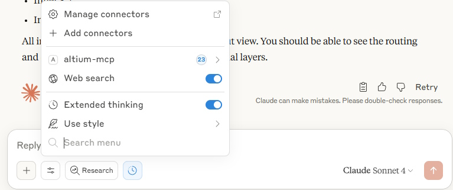

# Altium MCP Server

TLDR: Use Claude to control or ask questions about your Altium project.
This is a Model Context Protocol (MCP) server that provides an interface to interact with Altium Designer through Python. The server allows for querying and manipulation of PCB designs programmatically.

Note: Having Claude place components on the PCB currently fails hard.

## Example commands
- Run all output jobs
- Create a symbol for the part in the attached datasheet and use the currently open symbol as a reference example.
- Create a schematic symbol from the attached MPM3650 switching regulator datasheet and make sure to strictly follow the symbol placement rules. (Note: Need to open a schematic library. Uses `AppData\Roaming\Claude\Claude Extensions\local.dxt.altium-mcp\server\symbol_placement_rules.txt` description as pin placement rules. Please modify for your own preferences.)
- Find me the LM358 symbol in my opamp library and open it
- Create a multi-part symbol for a quad op-amp from the attached LM324 datasheet (creates parts A, B, C, D with shared V+/V- power pins)
- Create a PCB footprint for the SMD part in the attached datasheet and add it to my open PcbLib
- In the active PCB footprint library, set all pad shapes to rounded rectangle except footprint 53398-0271
- In the active PCB footprint library, move all primitives from Mechanical 13 to Mechanical 1 and Mechanical 15 to Mechanical 3, except footprint 53398-0271
- In the active PCB footprint library, create Draftsman-style projections of embedded 3D STEP bodies on Mechanical 2 with 0.1 mm tracks, except footprint 53398-0271
- List every footprint in the active PCB footprint library
- Duplicate my selected layout. (Will prompt user to now select destination components. Supports Component, Track, Arc, Via, Polygon, & Region. Use `layout_duplicator_apply_groups` when copying the same selected routing to multiple destinations.)
- Show all my inner layers. Show the top and bottom layer. Turn off solder paste.
- Rename PCB layer 4 back to Int2 DDR and layer 32 back to Bottom Layer.
- Clear the Route Tool Path layer override so Top Layer displays with its normal layer-stack name.
- Get me all parts on my design made by Molex
- Give me the description and part number of U4
- Place the selected parts on my pcb with best practices for a switching regulator. Note: It tries, but does terrible placement. Hopefully I can find a way to improve this.
- Give me a list of all IC designators in my design
- Get me all length matching rules

## Installing the MCP Server
The easiest way to install is to use Claude Code, point it to this repo and ask it to install it for you. Or alternatively, see below.

[Watch on YouTube](https://youtu.be/HKQMK-hluLs)

1. Make sure Claude has Python 3.10+ installed: `drop down > File > Settings > Extensions > Advanced > Python`. If not, install Python and add it to PATH.
2. Download the `altium-mcp.dxt` desktop extension file from [releases](https://github.com/coffeenmusic/altium-mcp/releases)
3. In Claude Desktop on Windows: `drop down > File > Settings > Extensions > Advanced > Install Extension...` Select the .dxt file

You shouldn't need to restart Claude and you should now see altium-mcp in the tool menu near the search bar.



## Creating a new .dxt (For Developers)

### Bootstrap Venv (Recommended)

This approach ships a small bootstrap script (`start_server.py`) that creates a virtual environment and pip-installs dependencies on the user's machine at first launch. The .dxt is tiny (~60 KB) and works across any Python 3.10+ version.

The older approach of bundling pre-compiled packages in `server/lib/` is no longer recommended — it breaks when the user's Python version doesn't match the version used to build the bundled `.pyd` files (e.g. pydantic_core compiled for 3.11 fails on 3.13).

**How it works:**

1. `start_server.py` (at the repo root) checks for `server/.venv/Scripts/python.exe`
2. If the venv doesn't exist, it creates one and pip-installs the pinned dependencies
3. It then launches `server/main.py` using the venv's Python
4. First launch takes ~20-30 seconds; subsequent launches are instant

**Build steps:**

1. Make sure `start_server.py` exists at the repo root (see below for contents)
2. Make sure `server/main.py` does NOT have the old `site.addsitedir` hack at the top
3. Update `manifest.json`: set `entry_point` to `start_server.py`, remove any `env`/`PYTHONPATH` fields, and use `manifest_version: "0.3"`
4. Package the DXT — either use `dxt pack` or manually zip and rename:
```powershell
Compress-Archive -Path manifest.json, start_server.py, pyproject.toml, server -DestinationPath altium-mcp.zip
Rename-Item altium-mcp.zip altium-mcp.dxt
```

**Do NOT include `server/lib/` or `server/.venv/` in the .dxt.** The whole point is that these are created on the user's machine.

**`start_server.py`:**
```python
import subprocess
import sys
from pathlib import Path

SCRIPT_DIR = Path(__file__).parent
VENV_DIR = SCRIPT_DIR / "server" / ".venv"
REQUIREMENTS = [
    "mcp[cli]==1.5.0",
    "pillow>=11.1.0",
    "pywin32>=310",
]

def ensure_venv():
    python_exe = VENV_DIR / "Scripts" / "python.exe"
    if python_exe.exists():
        return str(python_exe)

    subprocess.check_call([sys.executable, "-m", "venv", str(VENV_DIR)])
    pip_exe = str(VENV_DIR / "Scripts" / "pip.exe")
    subprocess.check_call([pip_exe, "install", "--quiet"] + REQUIREMENTS)
    return str(python_exe)

if __name__ == "__main__":
    venv_python = ensure_venv()
    server_path = str(SCRIPT_DIR / "server" / "main.py")
    sys.exit(subprocess.call([venv_python, server_path]))
```

**`manifest.json` server section:**
```json
"server": {
    "type": "python",
    "entry_point": "start_server.py",
    "mcp_config": {
      "command": "python",
      "args": ["${__dirname}/start_server.py"]
    }
  }
```

### Pitfalls

These are hard-won lessons from debugging DXT builds. Violating any of these will produce errors that are difficult to diagnose.

1. **Do NOT use `os.execv()` in `start_server.py`.** The DXT installs to a path containing spaces (`Claude Extensions`). On Windows, `os.execv` splits the path at the space and fails. Use `sys.exit(subprocess.call([...]))` instead.

2. **Pin `mcp` to `==1.5.0`.** Using `>=1.5.0` pulls in the latest version, which has breaking API changes (`FastMCP.__init__()` dropped the `description` kwarg). The server code was written against 1.5.0.

3. **Do NOT use `manifest_version: "0.4"` with `"type": "uv"`.** Claude Desktop does not support it yet. You will get `Invalid manifest: server: Required`. Use `"type": "python"` with `manifest_version: "0.3"`.

4. **After removing the `site.addsitedir` hack from `main.py`, fix the `pathlib.Path` reference.** The hack included `import pathlib` at the top of the file. The logging setup later uses `pathlib.Path(...)` which will throw `NameError` once that import is gone. Change it to `Path(...)` — the `from pathlib import Path` import already exists in the file, just make sure it comes before the logging setup.

5. **Do NOT bundle `server/lib/` in the DXT.** That was the old approach and defeats the purpose of the venv bootstrap.

### Legacy: Bundled server/lib (Not Recommended)

This approach bundles all dependencies in `server/lib/` and sets `PYTHONPATH` to point to it. It produces a much larger .dxt (~17 MB) and **only works if the user's Python version matches the version used to compile the bundled packages**.

1. Populate packages: `python -m pip install --no-cache-dir --target server/lib -r requirements.txt`
2. Set the manifest `entry_point` to `server/main.py` and add `"env": {"PYTHONPATH": "${__dirname}/server/lib"}` to `mcp_config`
3. Package: `npm install -g @anthropic-ai/dxt && dxt pack`

### DXT Resources
- [Desktop Extensions](https://www.anthropic.com/engineering/desktop-extensions)
- [Desktop Extensions Github](https://github.com/anthropics/dxt)
- [Getting Started with DXT](https://support.anthropic.com/en/articles/10949351-getting-started-with-local-mcp-servers-on-claude-desktop)
- [Python DXT Example Code](https://github.com/anthropics/dxt/tree/main/examples/file-manager-python)
- [DXT Manifest](https://github.com/anthropics/dxt/blob/main/MANIFEST.md)


## Configuration

When launching claude for the first time, the server will automatically try to locate your Altium Designer installation. It will search for all directories that start with `C:\Program Files\Altium\AD*` and use the one with the largest revision number. If it cannot find any, you will be prompted to select the Altium executable (X2.EXE) manually when you first run the server. Altium's DelphiScript scripting is used to create an API between the mcp server and Altium. 

## Available Tools

The server provides several tools to interact with Altium Designer:

### Output Jobs
- `get_output_job_containers`: Using currently open .OutJob file, reads all available output containers
- `run_output_jobs`: Pass a list of output job container names from the currently open .OutJob to run any number of them. `.OutJob` must be the currently focused document.

### PCB image exports

- `export_pcb_3d_image`: Export one native orthographic top or bottom PCB 3D PNG without creating or opening an OutJob. The default is 600 DPI. Optional `workspace_color`, `board_color`, `solder_mask_color`, `silk_color`, and `copper_color` arguments accept `#RRGGBB`; omit all colors to use the current Altium 3D colors.
- `export_pcb_3d_images`: Export both `pcb-3d-top.png` and `pcb-3d-bottom.png` with the same DPI and color options.
- `export_pcb_assembly_images`: Export top and bottom Mechanical 2 assembly artwork, pad geometry, and the actual board contour. PNG output is RGBA with transparent background and defaults to 600 DPI. The board contour is black and 0.1 mm wide by default; `top_color`, `bottom_color`, `outline_color`, and bottom mirroring are configurable. Set `keep_svg=true` to retain the vector files and their pad metadata.
- `export_component_assembly`: Export the requested PCB component's Mechanical 2 assembly artwork and pads as both SVG and transparent RGBA PNG. This reuses EasyEDA-Loader's normal shape SVG conversion, including its arc, region, track, text, flipped-layer, component-origin, and pad-contour handling.

All SVG exports that include pads place them in `<g id="Pads" data-layer="pads">`. Each pad path stores its Altium pad number without drawing extra text, for example `<path id="U1-pad-1" data-component="U1" data-footprint="QFN-32" data-pad-number="1" data-pad-index="17" .../>`. The pad number is the PCB pad designator used by Altium's schematic-pin-to-footprint-pad mapping. On panelized boards, repeated designators receive unique SVG IDs and a `data-instance` suffix while retaining the original `data-component`. SVG grouping and metadata do not survive rasterization, but pad geometry is rendered into the PNG.

The two Mechanical 2 tools require the current EasyEDA-Loader Altium extension because they use its in-process named-pipe bridge. These commands are read-only: they do not modify or save the PCB/PcbLib document. Responses include `pad_count` and `pads_included`.

#### Using SVG pad numbers

When a task needs pad numbers, pin callouts, connector pinouts, or correspondence
with schematic pins, use the SVG metadata rather than OCR or the order of the
paths:

1. For a whole-board export, call `export_pcb_assembly_images` with
   `keep_svg=true`. `export_component_assembly` always retains its SVG.
2. Select `<path>` elements below `<g id="Pads" data-layer="pads">`.
3. Read `data-pad-number` as the Altium PCB pad designator used by the
   schematic-pin-to-footprint-pad mapping.
4. Read `data-component` for the logical component designator. On panelized
   boards, combine it with `data-instance` to distinguish repeated copies.
5. Use `data-footprint` when the footprint identity is also required.

Do not derive pad numbers from SVG path order, pad position, rendered PNG
pixels, or OCR. PNG exports contain the visible pad shapes but cannot retain the
SVG attributes.

All component and whole-board SVGs use millimetres for physical dimensions and
view-box/path coordinates. The root records `data-coordinate-units="mm"` and
uses `mm` suffixes for `width` and `height`. `BoardOutline` uses
`stroke="#000000"`, `stroke-width="0.1"`, and
`data-stroke-width-mm="0.1"`; because SVG user coordinates are millimetres, its
rendered width is 0.1 mm.
The `BoardShape` layer also contains real SVG `<circle>` elements for holes in
standalone pads when the drilled-hole diameter is at least 1 mm. These elements
carry `data-kind="standalone-mounting-pad"` and `data-hole-diameter-mm`.
Component-owned pads, standalone pads without holes, and vias are excluded from
this mounting-hole subgroup. The full drilled-hole circle must fit inside the
actual PCB outline; panel-rail pads outside that contour are excluded.

### Document Utilities
- `save_current_document`: Save the currently focused Altium document. Requires `user_requested=true`; use it only when the user explicitly asks to save.

### Project variant material changes

- `get_project_variants(project_name)`: Inspect one open PCB project's live
  variants, component IDs, variation kinds, alternate-part strings, and parameter
  overrides. Use the exact project basename without `.PrjPcb`, or its full path.
  The displayed variant label is `DM_Description`; `DM_Name` can simply be
  `Variant` and should not be used to select `E1_MOUNT`.
- `copy_project_variant_materials(source_project, target_project, variant_name,
  allow_missing=False, apply=False)`: Preflight a material-override copy. The
  default checks all source changes without creating a variant. Set `apply=True`
  to create the target variant. Missing components block by default; set
  `allow_missing=True` only after reviewing `skipped_designators`.

The implementation is in `server/AltiumScript/project_variants.pas`, registered in
`Altium_API.PrjScr`, with MCP wrappers in `server/main.py`. It uses open projects
and compiled schematic data. Each source designator must identify one component,
and its stored variant ID must match the compiled source ID. Each target match
must have the same base library reference, comment, and footprint. Overrides use
the **target** component's ID, so copied hierarchy IDs cannot silently attach to
another component. Ambiguous designators, stale source IDs, incompatible base
parts, and conflicting existing variants block the operation. An identical
existing variant returns `already_matches=true` without adding another variant.

This helper supports fitted components with parameter/material overrides only
(`DM_VariationKind=0`). It does not copy DNP states or alternate library models.
It preserves the source alternate-part string and all parameter name/value
overrides. In AD26, `DM_SetAlternatePart` automatically creates a `Comment`
override; the copier reuses that parameter to avoid duplicates. Every new
component variation is read back before success. On failure, the newly created
variant is removed; inspect the live state before retrying.

Example MCP arguments, first for preflight and then for applying reviewed skips:

```json
{"source_project":"SwarmRK_v1.6S","target_project":"MainRK_v1.6","variant_name":"E1_MOUNT"}
{"source_project":"SwarmRK_v1.6S","target_project":"MainRK_v1.6","variant_name":"E1_MOUNT","allow_missing":true,"apply":true}
```

The `SwarmRK_v1.6S` -> `MainRK_v1.6` copy verified on 2026-10-19 has these
14 applicable component changes and 28 parameter overrides:

| MainRK components | Variant `Comment` | Variant `PartNumber` |
| --- | --- | --- |
| HL2, HL3, HL5, HL6, HL7, HL8, HL10 | XL-1608SYGC-06 | =Comment |
| F1, F2, F3, F4, F5, F14, F16 | 0R | =Comment |

The source's `HL11`, `HL12`, and `F6` are absent from MainRK and were skipped.
Other MainRK components retain their base values. The strict preflight rejected
those missing components, the reviewed copy passed readback, and a repeat apply
returned `already_matches=true`.

**Save-state recovery:** These tools issue no save command. Keep Altium open for
inspection. On the tested AD26 project server, `SetModified(True)` did not make
`GetModified` return true even though the live variant and all 28 overrides were
present. Responses therefore expose `target_modified` and a `save_state_warning`
when persistence cannot be confirmed. A successful live readback does not prove
that the project is saved. Report this ambiguity; do not restart/close Altium,
save, or accept a save-copy prompt without the user's explicit instruction.

Existing MCP connections may need a **server reconnect** to discover the two new
tool names; Altium itself does not need a restart. Until reconnection, the existing
`move_pcb_library_mechanical_layers` tool can carry one project maintenance command
in `layer_moves`, with `exclude_footprint_names=[]`:

```text
PROJECT_VARIANTS_INSPECT|MainRK_v1.6
PROJECT_VARIANT_MATERIALS|SwarmRK_v1.6S|MainRK_v1.6|E1_MOUNT|TRUE|DRY_RUN
PROJECT_VARIANT_MATERIALS|SwarmRK_v1.6S|MainRK_v1.6|E1_MOUNT|TRUE|APPLY
```

The parser dispatches these commands before PCB-library operations. The dedicated
tools use `project_variant_maintenance`, which also bypasses document focusing.
After any timeout, inspect the target variant and its exact overrides before
retrying an apply. Put exported verification data under `generated/`.

### Component Information
- `get_all_designators`: Get a list of all component designators in the current board
- `get_all_component_property_names`: Get a list of all available component property names
- `get_component_property_values`: Get the values of a specific property for all components
- `get_component_data`: Get detailed data for specific components by designator
- `get_component_pins`: Get pin information for specified components

### Schematic/Symbol
- `get_schematic_data`: Get schematic data for specified components
- `create_schematic_symbol` ([YouTube](https://youtu.be/MMP7ZfmbCMI)): Passes pin list with pin type & coordinates to Altium script. Supports multi-part symbols (e.g. quad op-amps) via a `part_count` parameter and an `owner_part_id` field on each pin (use 0 for shared power/GND pins). Also supports active-low pin name overbars by placing a backslash after each overbarred character (e.g. `R\E\S\E\T\` renders as `RESET` with overbar). Symbol metadata can be passed in the same `pins` list with entries such as `Comment=<symbol_name>`, `Designator=DD?`, `Manufacturer=<name>`, `Parameter=PartNumber|=Comment`, `Parameter=ValueType|Микросхема`, `Parameter=<custom_name>|<custom_value_or_blank>`, `Footprint=<footprint_name>`, `FootprintLibrary=<library_name_or_path>`, and `PinDescription=<pin>|<datasheet description>`.
- Before creating or editing schematic symbols, read [server/symbol_placement_rules.txt](server/symbol_placement_rules.txt). This is the project rule set future chats should use for pin placement, connector designators, descriptions, and symbol styling.
- The default workflow for GOST schematic-library symbol creation is documented in [Schematic.md](Schematic.md). Use it by default for GOST schematic-library symbol creation, update, and review tasks. The standard MCP flow is `get_symbol_placement_rules` -> `search_library_symbol` -> `get_library_symbol_reference` -> `create_schematic_symbol`; pass GOST custom properties through `Comment=`, `Manufacturer=`, `Parameter=`, `Footprint=`, `FootprintLibrary=`, and `PinDescription=` metadata entries.
- `get_symbol_placement_rules`: Create symbol's helper tool that reads `~\AppData\Roaming\Claude\Claude Extensions\local.dxt.altium-mcp\server\symbol_placement_rules.txt` to get pin placement rules for symbol creation.
- `get_library_symbol_reference`: Create symbol's helper tool to use an open library symbol as an example to create the symbol
- `get_library_symbol_primitive_font_dump`: Read-only active SchLib symbol primitive/font audit. Dumps pins, rectangles, lines, labels, parameters, and FontManager-resolved fonts from the active in-memory library component; rectangle records include border `line_width`, outline colour, fill/area colour, and whether solid fill is enabled. GOST generated body rectangles use black outline color `0`, `#F8F8F8` fill color `16316664`, and solid fill enabled. Use this instead of reading `.SchLib` files directly when exact style/font auditing is needed.
- `search_library_symbol`: Search for a symbol by name in a schematic library (.SchLib) and navigate to it. Supports partial name matching. Will open the library file in Altium if a path is provided, or show a file picker if not.


### Layout Operations
- `get_all_nets`: Returns a list of unique nets from the pcb
- `create_net_class` ([YouTube](https://youtu.be/89booqRbnzQ)): Create a net class from a list of nets
- `get_pcb_layers`: Get detailed layer information including electrical, mechanical, layer pairs, etc.
- `get_pcb_layer_stackup`: Gets stackup info like dielectric, layer thickness, etc.
- `set_pcb_layer_visibility` ([YouTube](https://youtu.be/XaWs5A6-h30)): Turn on or off any group of layers. For example turn on inner layers. Turn off silk.
- `set_pcb_layer_names_by_id`: Rename PCB copper or mechanical layers by numeric `layer_id` from `get_pcb_layers`. Pass entries as `layer_id|new name`, for example `["1|Top Layer", "4|Int2 DDR", "32|Bottom Layer"]`. This changes layer-stack names only; it does not save the PCB document.
- `clear_pcb_route_tool_path_layer`: Clear Altium's route-tool-path layer override. Use this when a copper layer appears as `Route Tool Path` even after its layer-stack name has been restored.
- `get_pcb_rules`: Gets the rule descriptions for all pcb rules in layout.
- `get_selected_components_coordinates`: Get position and rotation information for currently selected components
- `move_components`: Move specified components by X and Y offsets
- `layout_duplicator` ([YouTube](https://youtu.be/HD-A_8iVV70)): Starts layout duplication assuming you have already selected the source components on the PCB.
- `layout_duplicator_apply`: Action #2 of `layout_duplicator`. Agent will use part info automatically to predict the match between source and destination components, then will send those matches to the place script.
- `layout_duplicator_apply_groups`: Multi-destination wrapper for `layout_duplicator_apply`. Use this after `layout_duplicator` when the selected source includes routing primitives and you want the same placement/routing copied to more than one destination group. It repeats the source designator list and flattens all destination groups into one Altium apply command, so tracks, vias, polygons, and regions are replicated for each group.
- `copy_pcb_polygon_geometry`: Copy the geometry of one named PCB polygon to another named PCB polygon. The target polygon keeps its original name, net, and layer; the command replaces only the target polygon geometry and leaves the PCB document dirty for inspection. Pass `source_polygon` and `target_polygon` as polygon names; the bridge also falls back to matching by net name if a polygon name is not available. The command does not save the PCB document.
- `copy_selected_fill_to_signal_layers`: Copy exactly one selected PCB fill or region to every other signal layer. The copies keep the source geometry and net, are selected when created, and the PCB document is left dirty for inspection. The command does not save the PCB document.
- `add_tented_vias_around_keepout_contour`: Add fully tented vias around the active PCB Keep-Out Layer contour. Parameters are `via_diameter_mm`, `via_hole_mm`, `edge_clearance_mm`, `pitch_mm`, and optional `net_name`; for example use `0.4`, `0.2`, `0.4`, `1.5`, and `GND` for 0.4 mm vias with 0.2 mm holes on GND, 0.4 mm clearance from the via outer diameter to keepout, and 1.5 mm pitch. Via centers are offset inside the contour by `edge_clearance_mm + via_diameter_mm / 2`, solder mask expansion is set manually to `-via_diameter_mm / 2` for top/bottom tenting, and the created vias are selected when the command finishes. The command leaves the PCB document dirty for inspection and does not save it.

When copying selected routing to multiple destinations, call `layout_duplicator_apply_groups` once instead of calling `layout_duplicator_apply` repeatedly. Repeated separate apply calls can move the same duplicated routing primitives from the previous destination to the next destination.

Example grouped apply payload:

```json
{
  "source_designators": ["C258", "C257", "R165", "R163", "L47", "DA8"],
  "destination_designator_groups": [
    ["C254", "C253", "R139", "R138", "L41", "DA5"],
    ["C256", "C255", "R142", "R140", "L42", "DA7"]
  ]
}
```

The cool thing about layout duplication this way as opposed to with Altium's built in layout replication, is that the exact components don't have to match because the LLM can look through the descriptions and understand which components match and which don't have a match. That's something that can't really be hard coded.


### PCB Footprint Library
- `get_pcblib_footprints`: Return every footprint name in the currently active `.PcbLib` document. The `.PcbLib` must be the focused document in Altium.
- `get_pcblib_footprint_primitives`: Return pads, tracks, arcs, text, and 3D body primitive data for one footprint in the active `.PcbLib` document.
- `create_pcb_footprint`: Create a new PCB footprint in the currently active .PcbLib document. Supports SMD pads (Rect, Round, and Oval/rounded-rectangle shapes) defined in mm relative to the component origin. Auto-generates a courtyard on Mech 15 and silkscreen with a pin 1 indicator (gap in the top-left corner), or accepts explicit courtyard dimensions. Rounded-rectangle pads use Altium's `eRoundedRectangular` pad shape enum. Contributed by [coffeedust](https://github.com/coffeedust) ([PR #7](https://github.com/coffeenmusic/altium-mcp/pull/7)).
- `set_pcb_library_pad_shapes`: Set all copper pad shapes in the currently active .PcbLib document to Rounded Rectangle, excluding any footprint names passed in `exclude_footprint_names` (for example `["53398-0271"]`). Uses Altium's `eRoundedRectangular` pad shape enum.
- `move_pcb_library_mechanical_layers`: Move primitives between mechanical layers in the currently active .PcbLib document, excluding any footprint names passed in `exclude_footprint_names` (for example `["53398-0271"]`). Layer moves are passed as `source|destination` strings in `layer_moves`, for example `["13|1", "15|3"]`.

#### Footprint descriptions

Footprint descriptions must describe the part using useful datasheet or product-page facts, not the generation method. Include the manufacturer or series, connector/package role, position or pin count, pitch, orientation/entry style, mating or stacking height, and important ratings when they are relevant to footprint selection. Do not include provenance text such as `generated from ...`, `copied from ...`, or a reference-footprint name.

#### Adding 3D STEP bodies to PcbLib footprints

Use the vendor STEP file unchanged. Do not rotate, mirror, translate, or add PcbLib-origin offsets to the STEP geometry itself. Altium stores a generic STEP body's placement separately from the model file, using the 3D Body location, model rotation, and standoff/height fields.

The common placement state is:

- body location: X/Y in the footprint/PcbLib coordinate system.
- model orientation: Rotation X, Rotation Y, and Rotation Z in the Generic 3D Model properties.
- vertical placement: Generic STEP model Z offset plus Overall Height. Keep the component-body standoff metadata at `0 mm` unless the footprint has a documented reason to use it.

For an already embedded PcbLib 3D body, the authoritative placement is the model state stored with that embedded body: `MODEL.2D.X`, `MODEL.2D.Y`, `MODEL.3D.ROTX`, `MODEL.3D.ROTY`, `MODEL.3D.ROTZ`, and `MODEL.3D.DZ`. Treat every embedded model as an independent placement case. Do not infer Z from footprint names, mating height text, pin count, or sibling/family consensus, because vendor STEP origins can differ between otherwise similar models. When the embedded model state is available, use `MODEL.3D.DZ` as `model_z_mm` and report `computed_contact_plane_method=embedded_model_state`. Use transformed STEP-topology contact-plane detection only as a fallback for a new/imported model that has no embedded placement state yet. In generated diagnostics, `computed_model_z_mm` is the value to pass as the `3D_BODY_SET_PLACEMENT` model-Z argument, `computed_model_z_source` identifies whether the value came from embedded model state or geometry fallback, and `computed_body_standoff_height_mm` should remain `0`.

For documents with a non-zero PcbLib board origin, keep the correction in the body/model placement state. If code or a metadata tool writes raw PcbLib coordinates, calculate:

```text
raw_x = Board.XOrigin + local_footprint_x
raw_y = Board.YOrigin + local_footprint_y
```

`Board.XOrigin` and `Board.YOrigin` can be non-zero in a PcbLib, so a footprint-local body center at `(0, 0)` may be stored at raw coordinates offset by the library origin. Read those origin values from `3D_BODY_DUMP` and apply them only to the Altium body snap point. Do not edit STEP `CARTESIAN_POINT` records to compensate for a PcbLib origin.

The safe manual Altium flow is:

1. Focus the target footprint in the `.PcbLib`.
2. Place/import the original vendor STEP as a Generic 3D Body.
3. Set the 3D Body `Identifier` to the STEP model file name without its extension, for example `DF40C-10DP-0.4V` for `DF40C-10DP-0.4V.stp`.
4. Set X/Y, Rotation X/Y/Z, Model Z/Standoff Height, and Overall Height in Altium's 3D Body Properties panel.
5. If scripted import left the body at raw local coordinates instead of origin-adjusted PcbLib coordinates, run `3D_BODY_FIX_ORIGIN_OFFSET|<footprint>` or `3D_BODY_FIX_ORIGIN_OFFSET|*`. This moves the Altium 3D body object by `Board.XOrigin`/`Board.YOrigin`; it does not edit STEP geometry or model rotation.
6. Run `3D_BODY_DUMP` and verify the origin-corrected `left_mm`, `right_mm`, `bottom_mm`, and `top_mm` are centered around the footprint.
7. After any scripted PcbLib modification, run `PCB_POSTPROCESS` before saving. Treat this as the standard end-of-job cleanup for PcbLib work, even when the command appeared to finish normally.

The script may safely create a basic STEP body container and set supported `IPCB_ComponentBody` identifier and height fields:

```pascal
PcbLib.CurrentComponent := Footprint;
Board := PcbLib.Board;

StepBody := PCBServer.PCBObjectFactory(eComponentBodyObject, eNoDimension, eCreate_Default);
StepBody.Layer := ILayer.MechanicalLayer(1);
Model := StepBody.ModelFactory_FromFilename(StepPath, False);
StepBody.Model := Model;
StepBody.SetState_FromModel;
StepBody.Layer := ILayer.MechanicalLayer(1);
StepBody.SetState_Identifier(StepIdentifierFromPath(StepPath));
StepBody.StandoffHeight := MMsToCoord(StandoffMm);
StepBody.OverallHeight := MMsToCoord(OverallHeightMm);

PCBServer.SendMessageToRobots(StepBody.I_ObjectAddress, c_Broadcast, PCBM_BeginModify, c_NoEventData);
Board.AddPCBObject(StepBody);
PCBServer.SendMessageToRobots(StepBody.I_ObjectAddress, c_Broadcast, PCBM_EndModify, c_NoEventData);
```

Do not use DelphiScript to transform the STEP model data. Apply placement through the 3D Body object/model state and leave the STEP file byte-for-byte unchanged. In Altium Designer 26.6, the following have caused compile errors or `ScriptingSystem.dll` access violations:

- assigning non-existent properties such as `Body.ModelRotationX` or `Model.ROTX`.
- assigning `IPCB_ComponentBody.X`, `IPCB_ComponentBody.Y`, `RotationX`, `RotationY`, or `RotationZ` from the PcbLib script path, either before or after `Board.AddPCBObject`.
- assigning `IPCB_Primitive.Identifier` directly. Use `IPCB_ComponentBody.SetState_Identifier(...)` instead.
- using .NET/property-panel wrapper members from DelphiScript, such as `GetState_ModelDescriptorString`.
- calling `IPCB_Model.SetState(...)` without pushing the model back onto the body and rebuilding the body from the model.
- deleting existing 3D bodies and re-importing replacements in the same scripted operation.

`3D_BODY_IMPORT|...` never deletes or replaces existing bodies. It imports only into an empty footprint, applies the filename-stem Identifier rule, and returns the resulting placement values for review.

The generic scripted placement sequence for an existing body is:

```pascal
Model := Body.GetModel;
Model.SetState(RotX, RotY, RotZ, MMsToCoord(ModelZMM));
Body.SetModel(Model);
Body.SetState_FromModel;
Body.SetState_SnapPointX(Board.XOrigin + MMsToCoord(LocalXMM));
Body.SetState_SnapPointY(Board.YOrigin + MMsToCoord(LocalYMM));
Body.StandoffHeight := MMsToCoord(StandoffMM);
Body.OverallHeight := MMsToCoord(OverallHeightMM);
```

`SetState_FromModel` can reset the body reference point, so always set `SetState_SnapPointX/Y` after it. Reapply `Model.SetState` and `Body.SetModel` after `SetState_FromModel` if Altium clears the Generic model rotation or Z field. Add `Board.XOrigin`/`Board.YOrigin` when writing raw snap points so the 3D body stays in the footprint coordinate frame.

3D Body Identifier rule: every Generic STEP 3D Body `Identifier` must equal the model file base name without the extension. New bodies created by `3D_BODY_IMPORT` and `3D_BODY_BATCH_IMPORT` apply this rule from `StepPath` automatically through `IPCB_ComponentBody.SetState_Identifier(...)`. For existing bodies, use `3D_BODY_SET_IDENTIFIER` or `3D_BODY_BATCH_SET_IDENTIFIER`; do not write `Primitive.Identifier` directly.

When only the visible Generic model Z offset must change, preserve the current X/Y and rotations exactly, then write only the new `model_z_mm` through the model state. In this MCP helper that means using `3D_BODY_SET_PLACEMENT` with the captured current local X/Y and Rotation X/Y/Z values plus the new `model_z_mm`; do not use it to recalculate or "helpfully" change X/Y or rotations.

Use `3D_BODY_SET_HEIGHTS|<footprint>|<standoff_mm>|<overall_height_mm>` only for `IPCB_ComponentBody.StandoffHeight`/`OverallHeight` metadata corrections. In Altium Designer 26.6 this may not update the Generic 3D Model panel's effective Z/Standoff field.

Do not recenter a 3D body by its bounding rectangle after setting the snap point. The Generic STEP model reference point and the visible bounding-box center are not guaranteed to be the same, so snap-point plus bounding-box movement can drift X/Y placement.

Avoid part-number-specific refresh or generator helpers in the common MCP script. Use explicit footprint names, explicit STEP file paths, and explicit Altium placement values, then verify placement with `3D_BODY_DUMP` before saving.

Supported generic helper commands:

- `3D_BODY_DUMP`: reports body bounding boxes, raw coordinates, board origin, standoff height, and overall height.
- `3D_BODY_SET_IDENTIFIER|<footprint>|<identifier>`: updates existing component-body Identifier metadata with `IPCB_ComponentBody.SetState_Identifier(...)`. Use the STEP model file base name without extension.
- `3D_BODY_BATCH_SET_IDENTIFIER|<data_file>`: updates existing Generic 3D Body identifiers from a pipe-delimited batch file. Each non-comment line must be `IDENTIFIER|<footprint>|<identifier>`. This is the preferred helper when applying the filename-stem Identifier rule across a PcbLib.
- `3D_BODY_IMPORT|<footprint>|<step_path>|<local_x_mm>|<local_y_mm>|<rot_x_deg>|<rot_y_deg>|<rot_z_deg>|<model_z_mm>|<standoff_mm>|<overall_height_mm>`: imports a STEP model into an empty footprint and automatically sets the body Identifier to the STEP file base name without extension.
- `3D_BODY_BATCH_IMPORT|<data_file>|<skip_existing>`: imports STEP models from `BODY|...` records and applies the same automatic Identifier rule for each placed body.
- `3D_BODY_SET_HEIGHTS|<footprint>|<standoff_mm>|<overall_height_mm>`: updates existing component-body standoff/overall-height metadata without touching STEP geometry, X/Y placement, snap point, or model rotation. Use `*` as the footprint name to update all footprints.
- `3D_BODY_SET_PLACEMENT|<footprint>|<local_x_mm>|<local_y_mm>|<rot_x_deg>|<rot_y_deg>|<rot_z_deg>|<model_z_mm>|<standoff_mm>|<overall_height_mm>`: updates an existing Generic 3D Body's Altium placement state. It uses `IPCB_Model.SetState`, `IPCB_ComponentBody.SetModel`, `SetState_FromModel`, then `SetState_SnapPointX/Y` with `Board.XOrigin + local_x` and `Board.YOrigin + local_y`. It does not transform or rewrite the STEP file.
- `3D_BODY_BATCH_SET_PLACEMENT|<data_file>`: updates existing Generic 3D Bodies from a pipe-delimited batch file. Each non-comment line must be `PLACE|<footprint>|<local_x_mm>|<local_y_mm>|<rot_x_deg>|<rot_y_deg>|<rot_z_deg>|<model_z_mm>|<standoff_mm>|<overall_height_mm>`. Use this for repeated Z-only repairs only after capturing each footprint's current X/Y and rotations; the command writes every field in the record.
- `3D_BODY_SET_COLOR|<red>|<green>|<blue>`: sets `OverrideColor=True` and `BodyColor3D` for existing component bodies in all non-excluded footprints. RGB channels are 0-255; Altium stores the packed value as `red + 256 * green + 65536 * blue`.
- `3D_BODY_FIX_ORIGIN_OFFSET|<footprint>`: moves existing 3D bodies whose raw bounding rectangle is still near local origin by the active PcbLib `Board.XOrigin`/`Board.YOrigin`. Use `*` as the footprint name to repair all unshifted bodies while skipping already-shifted bodies.
- `PCB_LIB_OPEN|<pcblib_path>`: opens or focuses a `.PcbLib` by absolute path through Altium and reports the active library path and footprint count. Use this before read-only research commands when the target library is named by path instead of already being focused.
- `PCB_LIB_STATS_DUMP|<footprint>`: dumps compact read-only footprint statistics for one footprint, or use `*` for every footprint in the active PcbLib. The result includes descriptions, primitive counts, pad layers, pad shapes, pad sizes, drawing layers, text strings, and 3D body layer/height summaries; prefer this for library research before using full primitive dumps.
- `FOOTPRINT_PRIMITIVE_DUMP|<footprint>`: dumps pads, tracks, arcs, regions, and body primitives for a single footprint.
- `PCB_LIB_DESCRIPTION_DUMP|<footprint>`: dumps footprint descriptions. Use `*` as the footprint name to inspect all footprints in the active PcbLib.
- `PCB_LIB_SET_DESCRIPTION|<footprint>|<description>`: updates a footprint description with datasheet/product-page facts. Pass one command per footprint; do not use it to write generation provenance.
- `PCB_LIB_CLEAN_PADS_OVERLAY|<target_name_contains>|<pad_name_prefix>|<overlay_layer>`: selects matching footprints, deletes pads whose names start with the prefix, and deletes tracks/arcs on the named overlay layer through Altium's editor delete process. Use it before a `PCB_LIB_BATCH_CREATE|...|FALSE` refresh when replacing generated mounting pads and overlay graphics.
- `PCB_LIB_JOIN_SELECTED_PADS_CUSTOM`: joins the active footprint's supported duplicate same-name stepped pad pair into one Altium custom-shape pad. The command builds a temporary rounded track/arc contour, invokes Altium's `PCB:CustomPadShape` `Action=Convert|Object=Track` editor command, and leaves the converted custom pad plus temporary/source primitives for readback before cleanup.
- `PCB_LIB_JOIN_SELECTED_PADS_CUSTOM_PREPARE`: prepares and selects the anchor pad plus temporary rounded contour without invoking conversion. Use this for diagnostics when Altium selection or conversion behavior needs to be inspected.
- `PCB_LIB_JOIN_SELECTED_PADS_CUSTOM_CONVERT`: invokes only Altium's custom-pad contour conversion command against the current selection.
- `PCB_LIB_JOIN_SELECTED_PADS_CUSTOM_CLEANUP`: after verifying conversion, deletes the duplicate source pad and temporary 0.001 mm Top Layer contour primitives through Altium's editor delete path. Do not use direct `Footprint.RemovePCBObject` cleanup for this flow.
- `PCB_LIB_JOIN_SELECTED_PADS_CUSTOM_REBUILD_SOURCE`: repairs an already converted test footprint by deleting pad `3` custom/source/temp primitives and recreating the original two rounded pad `3` source pads used by the join workflow. This is a recovery/debug helper, not a general footprint generator.
- `PCB_LIB_BATCH_CREATE|<data_file>|<skip_existing>`: creates or populates PcbLib footprints from a pipe-delimited data file with `FOOTPRINT`, `PAD`, `TRACK`, `ARC`, `TEXT`, and `END` records. Use this for generic batch footprint work only; keep part-family tables in a task-local file, not in the common script or README. The helper writes raw primitive coordinates through the active PcbLib board using `Board.XOrigin + local_x` and `Board.YOrigin + local_y`, so it works with non-zero PcbLib origins.
- `PCB_POSTPROCESS`: call after any PcbLib modification to close any leftover PCB server transaction and redraw the editor. Use it as the final MCP call after scripted PcbLib work so Altium can save normally.

For custom pad joins, always read back the footprint after conversion before cleanup. A correct final readback should show one pad with the original pad name and `top_shape=10`, no duplicate same-name source pad, and no temporary Top Layer tracks/arcs with `0.001 mm` width. Run `PCB_POSTPROCESS` after cleanup and do not save the PcbLib unless explicitly requested.

When verifying a 3D placement update, run the selected mutating command and `PCB_POSTPROCESS` as separate MCP calls so the placement result is visible in the tool response before the refresh result. For a Generic model Z-only update, use `3D_BODY_SET_PLACEMENT` with unchanged current X/Y and rotations.

For user-requested PcbLib edit sessions, finish the job by running `PCB_POSTPROCESS` after the last mutating command and before the final response. Do not save the library automatically unless the user explicitly asks for saving; leave the document dirty for user inspection.

When sending descriptions through `layer_moves`, prefer semicolon-separated clauses instead of commas. The MCP command transport treats commas as list delimiters in some paths.

Example placement repair after a body imported with the right STEP file but default Generic model orientation:

```text
move_pcb_library_mechanical_layers(
  exclude_footprint_names=[],
  layer_moves=["3D_BODY_SET_PLACEMENT|<footprint>|<local_x_mm>|<local_y_mm>|<rot_x_deg>|<rot_y_deg>|<rot_z_deg>|<model_z_mm>|<standoff_mm>|<overall_height_mm>"]
)
```

Example batch placement file:

```text
# PLACE|footprint|local_x_mm|local_y_mm|rot_x|rot_y|rot_z|model_z_mm|body_standoff_mm|overall_height_mm
PLACE|CONN_A|1.25|-0.5|90|0|270|0.65|0|3.46
PLACE|CONN_B|2.5|-0.5|90|0|270|-1.95|0|3.46
```

```text
move_pcb_library_mechanical_layers(
  exclude_footprint_names=[],
  layer_moves=["3D_BODY_BATCH_SET_PLACEMENT|D:\path\pcblib_3d_body_placements.txt"]
)
```

Keep family-specific placement tables outside this README. The common workflow is to capture placement from a known-good footprint or mechanical drawing, apply it with `3D_BODY_SET_PLACEMENT`, and verify the resulting raw and origin-corrected body bounds with `3D_BODY_DUMP`.

#### 3D STEP silhouette projections

The PcbLib mechanical-layer tool also has internal commands used to create Draftsman-style 2D silhouettes from embedded 3D STEP bodies. The intended flow is:

1. Focus the target `.PcbLib` in Altium.
2. Run `3D_BODY_DUMP` through `move_pcb_library_mechanical_layers` to dump each non-excluded footprint's 3D body bounding rectangle and active library path into `C:\Users\Public\altium_mcp\response.json`.
3. Extract the embedded STEP model streams from that active PcbLib:
   ```powershell
   python tools\extract_pcblib_embedded_steps.py
   ```
   With no arguments, the extractor reads the `library_path` from the last `3D_BODY_DUMP` response and writes the original embedded model names to `C:\Users\Public\altium_mcp\embedded_3d_models`. You can also pass paths explicitly:
   ```powershell
   python tools\extract_pcblib_embedded_steps.py "D:\path\Library.PcbLib" "C:\Users\Public\altium_mcp\embedded_3d_models"
   ```
4. Generate STEP silhouette segments:
   ```powershell
   python tools\generate_step_silhouette.py
   ```
   The generator reads the last `3D_BODY_DUMP` response, finds the extracted `.step`/`.stp` file by the PcbLib `MODEL.NAME` metadata first, and writes `C:\Users\Public\altium_mcp\3d_body_silhouette.txt`. The output file may contain both `LINE` and `ARC` records; the optimizer deduplicates identical edges, merges collinear overlapping line segments, rejects primitives covered by longer merged primitives, and converts circular polyline runs to real arcs when the fitted arc stays inside the source geometry bounds. It uses the intended 0.1 mm projection stroke as a visibility threshold, but keeps stroke-length line bridges so body-to-pad/lead connections are not opened by pruning. After pruning, it also bridges small collinear line gaps up to 2.5 times the projection stroke so STEP edge visibility does not leave artificial breaks between adjacent projected body and lead features. Arcs shorter than the stroke and arcs with a radius smaller than the stroke are dropped, then remaining small primitives are sampled and removed when their centerline is already inside another line or arc stroke.
5. Remove old generated tracks with `3D_BODY_EDITOR_CLEAN|<mechanical_layer>|<line_width_mm>`.
6. Append the generated segments with `3D_BODY_SILHOUETTE_APPEND|<mechanical_layer>|<line_width_mm>`.
7. Add `.Designator` and `.Comment` special strings with `3D_BODY_TEXT|<mechanical_layer>`, for example `3D_BODY_TEXT|2`. To update a single footprint during tuning, pass its name as a third field, for example `3D_BODY_TEXT|2|FOOTPRINT_NAME`. Text style and placement are defined in code as TrueType/Arial, 1.5 mm height. `.Comment` is centered below the projection with a 0.2 mm visual Y-axis gap. `.Designator` uses the rendered `.De` glyph box for alignment and projection-overlap checks; the generator searches around the projection center for the nearest clear anchor position before falling back 0.2 mm above the projection.
8. Verify with `3D_BODY_TRACK_COUNT|<mechanical_layer>|<line_width_mm>`.

The extractor reads Altium's OLE compound-file `Models` storage directly and decompresses the embedded zlib STEP streams. Do not use a manually downloaded model when the PcbLib has `MODEL.EMBED=TRUE`; extract the embedded stream and keep its original `MODEL.NAME` filename.

Do not infer projection rotation from footprint names. The generator reads the PcbLib's embedded model state records (`MODEL.NAME`, `MODEL.3D.ROTX`, `MODEL.3D.ROTY`, `MODEL.3D.ROTZ`, `MODEL.2D.ROTATION`, and `IDENTIFIER`) and derives the correction from that metadata. It prefers the exact extracted `MODEL.NAME` file, and it can also match a model identifier prefix to footprint variants when the naming scheme is shared. It applies that 3D placement before filtering the STEP topology to top-facing visible face boundaries, so hidden/back-side edges are not emitted. This keeps top-entry, side-entry, and future connector variants tied to their actual embedded 3D body placement instead of a hard-coded suffix.

The Altium importer accepts the new optimized `LINE`/`ARC` records and still accepts the legacy five-field line format. The cleanup, count, select, and text-placement helpers treat tracks and arcs as projection primitives, so rerunning `3D_BODY_EDITOR_CLEAN|layer|width` removes both primitive types.

For tuning the projection optimizer, select example generated tracks/arcs in the active footprint and run `3D_BODY_SELECTED_DUMP|<mechanical_layer>|<line_width_mm>`. The diagnostic returns selected primitive kind, local coordinates, line length or arc radius/sweep/length, and stroke width, which makes it easier to adjust the stroke-aware pruning thresholds without guessing.

Use `3D_BODY_PROJECTION|<mechanical_layer>|<line_width_mm>` only as a fallback. It draws the 3D body's bounding rectangle, not the real STEP silhouette.

Do not save the PcbLib automatically after these operations. Leave the document dirty and let the user inspect the mechanical layer and save manually.

#### PcbLib save-state recovery

If a PcbLib-modifying script hit an access violation or Altium later refuses to save with `A command is currently active and save cannot be completed at this time`, first cancel any active interactive command with `Esc`, then run the PcbLib save-state recovery command once:

```text
move_pcb_library_mechanical_layers(
  exclude_footprint_names=[],
  layer_moves=["PCB_POSTPROCESS"]
)
```

`PCB_POSTPROCESS` intentionally calls `PCBServer.PostProcess`, then sends `PCB:Cancel`, clears selection, and redraws the PCB editor. This is both the normal finishing step for scripted PcbLib edits and a recovery for an unmatched `PCBServer.PreProcess` left behind by a failed PcbLib script command. In the observed save-blocked state, sending `Esc` to Altium followed by `PCB_POSTPROCESS` released the active command and made the document saveable again.

If normal `Ctrl+S` still shows the warning after recovery, save through Altium's workspace process:

```text
move_pcb_library_mechanical_layers(
  exclude_footprint_names=[],
  layer_moves=["SAVE_DOCUMENT_CONFIRMED"]
)
```

In Altium Designer 26.6 this direct `WorkspaceManager:SaveObject` path succeeded after the PcbLib title still showed `*` and the normal save UI remained blocked. If the warning dialog appears, choose `No`; do not save a copy unless a separate duplicate library file is intended.

#### Deleting primitives from PcbLib safely

For PcbLib cleanup, prefer Altium's editor deletion path over direct object removal. Directly calling `Footprint.RemovePCBObject(Primitive)` on many primitives, especially after collecting them from a library footprint iterator, can destabilize Altium's scripting host and has caused `ScriptingSystem.dll` access violations.

Use this pattern instead:

1. Clear selection with `Client.SendMessage('PCB:DeSelect', 'Scope=All', 255, Client.CurrentView)`.
2. Set `PcbLib.CurrentComponent := Footprint` for the footprint being cleaned.
3. Refresh the view with `Board.ViewManager_FullUpdate` when `Board` is available.
4. Iterate the footprint's primitives and set `Primitive.Selected := True` only on objects that should be deleted.
5. Delete through the editor with `Client.SendMessage('PCB:DeleteObjects', 'Object=SELECTED', 255, Client.CurrentView)`.
6. Clear selection again and redraw with `Client.SendMessage('PCB:Zoom', 'Action=Redraw', 255, Client.CurrentView)`.

Use `Object=SELECTED` when more than one primitive may be selected. `Object=FOCUSED` can delete only one selected 3D body and leave stale duplicate bodies attached to the footprint.

The `3D_BODY_EDITOR_CLEAN|layer|width` command follows this select-and-delete approach for generated projection tracks. Avoid using direct-delete cleanup for generated PcbLib projections or 3D component bodies unless there is a very specific reason and it has been tested in the target Altium version.

### Both
- `get_screenshot`: Take a screenshot of the Altium PCB window or Schematic Window that is the current view. It should auto focus either of these if it is open but a different document type is focused. Note: Claude is not very good at analyzing images like circuits or layout screenshots. ChatGPT is very good at it, but they haven't released MCP yet, so this functionality will be more useful in the future.

### Server Status
- `get_server_status`: Check the status of the MCP server, including paths to Altium and script files

## Standalone document utilities

The repository includes two read-only/generation utilities that can be used
without starting Altium Designer or the MCP server. Both accept explicit input
and output paths; they do not contain board-specific paths.

### Inspecting Altium compound files

`tools/altium_cfb_inspect.py` reads selected records directly from Altium's OLE
compound-binary `PcbDoc` and `SchDoc` files. It does not modify the document.

List the streams stored in any supported document:

```powershell
python tools\altium_cfb_inspect.py streams "D:\path\Board.PcbDoc"
```

Read the bounding box of the PCB board-region contour in millimetres:

```powershell
python tools\altium_cfb_inspect.py board-bounds "D:\path\Board.PcbDoc"
python tools\altium_cfb_inspect.py board-bounds "D:\path\Board.PcbDoc" --json
```

Extract schematic text records from the `FileHeader` stream:

```powershell
python tools\altium_cfb_inspect.py schematic-text "D:\path\Sheet.SchDoc"
python tools\altium_cfb_inspect.py schematic-text "D:\path\Sheet.SchDoc" --json
```

The board-bounds command reports the axis-aligned bounds of the primary contour
stored in `BoardRegions/Data`. It is not a full parser for cut-outs or multiple
board regions.

### Generating a board-description DOCX

`tools/generate_board_description_docx.py` fills a two-column Word template
from UTF-8 JSON. The template controls the page size, margins, styles, table
appearance, and page breaks. It must contain two non-empty title paragraphs
before the first table and one two-column table per JSON section; every table
must contain a header row and at least one body row that can be cloned.

For the complete workflow—from inspecting the open Altium design through
content reconciliation and visual DOCX verification—use the repository skill
at `skills/create-board-description/SKILL.md`.

Install the project dependencies, then run:

```powershell
python tools\generate_board_description_docx.py `
  --template "D:\path\board-description-template.docx" `
  --data "D:\path\board-description.json" `
  --output "D:\path\board-description.docx"
```

The JSON structure is:

```json
{
  "title": "ТЕХНИЧЕСКИЕ ХАРАКТЕРИСТИКИ",
  "subtitle": "печатной платы ExampleBoard",
  "footer_label": "ExampleBoard",
  "metadata": {
    "title": "Технические характеристики печатной платы ExampleBoard",
    "subject": "Назначение и основные параметры"
  },
  "layout": {
    "left_column_dxa": 3685,
    "right_column_dxa": 5783
  },
  "sections": [
    {
      "number": "01",
      "title": "Общие сведения",
      "rows": [
        ["Назначение", "Описание назначения платы"],
        ["Габаритные размеры", "100 × 50 мм"]
      ]
    }
  ]
}
```

The optional `colors` object can override `heading_number`, `heading_text`,
`body_text`, `alternate_row`, `white`, and `footer` with six-digit RGB values.
The generator uses the supplied template as its layout source and replaces the
title, subtitle, section headings, table contents, footer label/page field, and
core document metadata.

### Generating an end-user connector manual

Use the separate end-user workflow when the deliverable is a user-facing board
manual rather than a PCB manufacturing description. Its JSON schema is
documented in
`skills/create-board-description/references/end-user-description-data.md`.
The workflow produces physical connector pinouts from Altium assembly SVGs,
1:1 top/bottom interface maps, and a DOCX with one pin per table row:

```powershell
python tools\crop_native_pcb_3d_export.py `
  --top "D:\path\pcb-3d-top.png" `
  --bottom "D:\path\pcb-3d-bottom.png" `
  --components "D:\path\component-records.json" `
  --board-width-mm 100 --board-height-mm 50 `
  --board-origin-x-mil 0 --board-origin-y-mil 0 `
  --output-dir "D:\path\connector-images"

python tools\generate_altium_connector_svgs.py `
  --data "D:\path\end-user-board.json" `
  --source-dir "D:\path\component-svg" `
  --board-top-svg "D:\path\pcb-assembly-top.svg" `
  --board-bottom-svg "D:\path\pcb-assembly-bottom.svg" `
  --output-dir "D:\path\pinout-svg"

python tools\generate_board_interface_maps.py `
  --data "D:\path\end-user-board.json" `
  --top-svg "D:\path\pcb-assembly-top.svg" `
  --bottom-svg "D:\path\pcb-assembly-bottom.svg" `
  --output-dir "D:\path\interface-maps"

node tools\rasterize_svg_directory.cjs `
  "D:\path\pinout-svg" "D:\path\pinout-svg" 300

node tools\rasterize_svg_directory.cjs `
  "D:\path\interface-maps" "D:\path\interface-maps" 300

python tools\generate_end_user_board_description_docx.py `
  --data "D:\path\end-user-board.json" `
  --output "D:\path\board-user-manual.docx"
```

Generate the assembly SVGs through the read-only Altium MCP exports with the
requested solder-mask color. The interface-map generator hides copper pads but
preserves `BoardShape/StandaloneMountingPads`; refresh stale assembly exports
when that group is absent instead of estimating mounting-hole positions.
Processor markers are data-driven through `interface_map_processors`, so the
reusable generator contains no board-specific designators.
Power-domain highlights apply only to rails shared by multiple connectors;
single-connector and mixed-rail domains stay unmarked. Each highlight follows
the native assembly body's unpadded extent without a border. SVG arc radii and
flags must not be treated as x/y coordinates when calculating that extent:
doing so can make curved connector highlights several times too large. The
power legend uses the same fill and opacity as the connector highlights, and
nearby power domains use visibly distinct hues. Inspect the rendered overlays
against the actual connector housings before embedding the maps in the DOCX.
The SVG rasterizer requires the `sharp` Node.js package. Its PNGs are mandatory
fallbacks for Word clients that do not render the embedded SVG part directly.
Write generated manuals, maps, pin-to-net exports, renders, reports, and
temporary work beneath the repository-root `generated/` directory. That
directory is intentionally ignored by Git; only generators, tests, skills,
and source assets belong in version control.

### Generating a board test-access description

Use `skills/create-board-test-description/SKILL.md` for the complete workflow
and `skills/create-board-test-description/references/test-description-data.md`
for the inventory and DOCX specification. Read the active PCB through Altium;
export top/bottom orthographic 3D images and assembly SVGs without saving the
design. The default solder mask is dark green (`#0B3D2B`), and the 3D
workspace is flat white. The export also writes `pcb-3d-registration.json`
with the physical camera bounds used for both sides.

`tools/generate_board_test_maps.py` produces top/bottom maps with actual
designators, a leader and circled anchor for each callout, and per-pad source
nets on qualifying drilled signal pads. It hides the copper `Pads` layer while
retaining only `StandaloneMountingPads` hole circles whose *full circle* fits
inside `BoardOutline`; panel-rail holes outside the PCB must not appear in the
SVG or DOCX. The board image keeps its aspect ratio when fitted to the page.

`tools/generate_board_test_3d_maps.py` applies the same labels and leader
routes to the corresponding orthographic 3D renders. Each annotated 3D page
follows its side's assembly-SVG map. The overlay has no drawn endpoint
circles; physical holes visible in the 3D render remain unchanged. The
render's aspect ratio is preserved. Pass the export's camera-registration JSON
to both this generator and `tools/crop_native_pcb_3d_export.py`. Altium's 3D
camera includes protruding component bodies, so mapping the assembly-SVG board
bounds directly across the PNG—or compensating with left/right alignment—will
shift labels and crop arrows. The bottom-side mirror is part of the recorded
registration. This is the common rule for every board: registration belongs to
one exact top/bottom PNG export and must be recreated when the board, DPI,
camera bounds, side, or image dimensions change. Never add per-board pixel
offsets or reuse another board's registration.

Current exporters render the Altium scene transparently onto the requested
flat workspace color. Older loaded extensions may still paint Altium's shaded
workspace even when white is requested; use
`tools/normalize_pcb_3d_background.py` for that legacy output, then reload the
rebuilt extension before the next export.

The test-description generators support `source`, `ru`, `en`, `zh`, and
combined `en-zh` language modes. Apply one mode consistently to the vector maps, 3D
maps, crop labels, and DOCX. Combined documents take a translation catalog for
board-specific prose; designators, nets, pad numbers, dimensions, and other
technical identifiers remain unchanged. See
`skills/create-board-test-description/references/test-description-data.md` for
the catalog schema and commands.

Set `board_name` to the exact Altium document or approved project identifier.
Do not remove or replace dots, underscores, hyphens, spaces, revision markers,
or other symbols for display. The test-description generator validates that the
localized title and subtitle both contain the verbatim board name.

After changing a map, regenerate both assembly and both annotated-3D SVGs,
then rasterize all four with
`tools/rasterize_svg_directory.cjs`, rebuild the DOCX with
`tools/generate_board_test_description_docx.py`, and verify that the embedded
SVGs and PNG fallbacks match the regenerated files. Inspect the embedded
assembly-SVG hole geometry and the 3D overlays as well as the rendered pages:
clipping can hide stale out-of-board circles in a preview.

## How It Works

The server communicates with Altium Designer using a scripting bridge:

1. It writes command requests to `workspace\request.json`
2. It launches Altium with instructions to run the `Altium_API.PrjScr` script
3. The script processes the request and writes results to `workspace\response.json`
4. The server reads and returns the response

The script runner procedure should include the `.pas` unit name:

```text
ProcName=Altium_API.pas>Run
```

## References
- Get scripts' project path from Jeff Collins and William Kitchen's stripped down version
- BlenderMCP: I got inspired by hearing about MCP being used in Blender and used it as a reference. https://github.com/ahujasid/blender-mcp
- Used CopyDesignatorsToMechLayerPair script by Petar Perisin and Randy Clemmons for reference on how to .Replicate objects (used in layout duplicator)
- Petar Perisin's Select Bad Connections Script: For understanding how to walk pcb primitives (track, arc, via, etc) connected to a pad
- Matija Markovic and Petar Perisin Distribute Script: For understanding how to properly let the GUI know when I've updated tracks' nets
- Petar Perisin's Room from Poly: Used as reference to detect poly to pad overlap since I couldn't get more tradition methods to work.
- Petar Perisin's Layer Panel Script: Used as reference for getting layers and changing layer visibility
- Jeff Collins has an XIA_Release_Manager.pas script that taught me the art of the Output Job. See his post on the Altium Forums: https://forum.live.altium.com/#/posts/189423

## Contributors
- [coffeedust](https://github.com/coffeedust) — `create_pcb_footprint` tool for PcbLib automation ([PR #7](https://github.com/coffeenmusic/altium-mcp/pull/7))
- [fwolter](https://github.com/fwolter) — Fix JSON parsing error when the decimal separator is a comma ([PR #3](https://github.com/coffeenmusic/altium-mcp/pull/3))

## Disclaimer
This is a third-party integration and not made by Altium. Made by [coffeenmusic](https://x.com/coffeenmusic)

# TODO:
- Change selection filter:
  - `scripts-libraries\Scripts - PCB\FilterObjects\`
  - `scripts-libraries\Scripts - SCH\SelectionFilter\`
- Show/Hide Panels: `DXP/ReportPCBViews.pas`
- Create rules: `PCB/CreateRules.pas`
- Run DRC: IPCB_Board.RunBatchDesignRuleCheck( 
- Move cursor to position: IPCB_Board.XCursor, IPCB_Board.YCursor 
- Add get schematic & pcb library path for footprint. 
- Add get symbol from library
- log response time of each tool
- Add go to schematic sheet
- Go to sheet with component designator
- Board.ChooseLocation(x, y, 'Test');
- Zoom to selected objects:
- Change Schematic Selection Filter: SelectionFilter.pas
- Place schematic objects (place component from library): PlaceSchObjects.pas
- How can I read through components from libraries in Components panel?

TODO Tests:
Need to add the following test units
- `get_pcb_layers` 
- `set_pcb_layer_visibility`
- `layout_duplicator`
- `get_pcb_screenshot`
